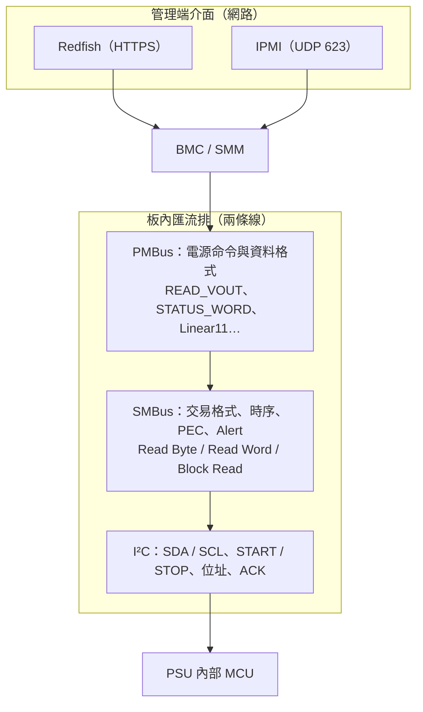
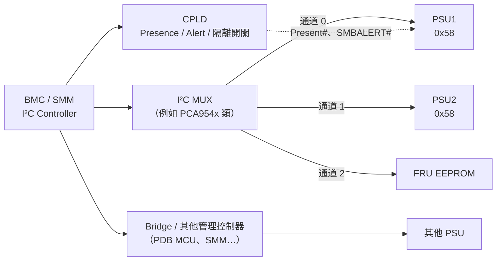

# I²C、SMBus、PMBus 的關係

> 📌 **一句話重點**：三者是**疊起來**的——**I²C** 定義兩條線怎麼傳 bit；**SMBus** 在其上規定更嚴格的電氣／時序與固定的交易格式；**PMBus** 再往上規定「電源管理的命令碼與資料格式」。Redfish／IPMI 則在完全不同的另一端（管理網路）。

## 1. 全景圖

| 層 | 回答的問題 | 類比 |
|---|---|---|
| **I²C** | bit 怎麼在兩條線上送？誰講話？送給誰？ | 對講機的物理規則：按下通話、報出呼號、說完放開 |
| **SMBus** | 一次「交易」由哪些 byte 組成？多久沒回應算逾時？ | 規定通話格式：「呼號→主題→內容→校驗」 |
| **PMBus** | 命令碼 0x8B 是什麼意思？回來的 2 bytes 怎麼換成伏特？ | 電力行業的專用術語表 |

## 2. I²C 基礎

**I²C（Inter-Integrated Circuit，唸作 I-squared-C 或 I-two-C）** 由 Philips（現 NXP）提出。

- 兩條線：**SDA**（Serial Data，資料）、**SCL**（Serial Clock，時脈）。
- **開汲極（Open-drain）＋上拉電阻**：任何裝置只能把線拉低，放開時由上拉電阻拉高。所以多個裝置可以共用同一對線。
- 角色：**Controller**（控制器，舊稱 Master）發起通訊並產生時脈；**Target**（目標，舊稱 Slave）依位址回應。BMC 是 Controller，PSU 是 Target。
- 速度：Standard 100 kHz、Fast 400 kHz、Fast-mode Plus 1 MHz。PMBus 常用 100 kHz（較新版本支援 400 kHz 以上）。

### 2.1 匯流排上的基本事件

| 事件 | 波形定義 | 意義 |
|---|---|---|
| **START (S)** | SCL 為高時，SDA 由高→低 | 開始一次通訊 |
| **STOP (P)** | SCL 為高時，SDA 由低→高 | 結束通訊、釋放匯流排 |
| **Repeated START (Sr)** | 不送 STOP 直接再送 START | 換方向（寫→讀）而不放掉匯流排 |
| **資料 bit** | SCL 低時改變 SDA；SCL 高時取樣 | 每 byte 8 bit，**MSB 先送** |
| **ACK (A)** | 第 9 個時脈，接收方把 SDA **拉低** | 「收到了」 |
| **NACK (N)** | 第 9 個時脈，SDA 維持**高** | 「沒人回應／不要了／不支援」 |

<svg viewBox="0 0 640 185" role="img" aria-label="I2C START、資料位元、ACK、STOP 的波形示意" style="width:100%;max-width:640px;display:block;margin:1em auto;font-family:ui-monospace,Consolas,monospace;font-size:12px">
  <g stroke="#b45309" stroke-dasharray="4 3" stroke-width="1"><path d="M70 28 V150"/><path d="M460 28 V150"/></g>
  <g fill="none" stroke-width="2.5" stroke-linejoin="round">
    <path stroke="currentColor" d="M30 40 H90 V70 H115 V40 H145 V70 H175 V40 H205 V70 H235 V40 H265 V70 H355 V40 H385 V70 H430 V40 H610"/>
    <path stroke="#2563eb" d="M30 110 H70 V140 H100 V110 H160 V140 H220 V110 H340 V140 H460 V110 H610"/>
  </g>
  <g fill="currentColor">
    <text x="2" y="59">SCL</text><text x="2" y="129" fill="#2563eb">SDA</text>
    <text x="50" y="170">START</text><text x="126" y="170">1</text><text x="186" y="170">0</text><text x="246" y="170">1</text>
    <text x="298" y="170">…</text><text x="352" y="170">ACK</text><text x="442" y="170">STOP</text>
    <text x="150" y="18">SCL 為高時 SDA 必須穩定；只有 START／STOP 例外</text>
  </g>
</svg>

圖 10-1　I²C 波形示意（非依比例；位元數已省略）

### 2.2 位址

- **7-bit 位址**（最常見）：可表示 0x00–0x7F，其中部分保留；實用範圍約 **0x08–0x77**。
- 10-bit 位址：存在但少見，PMBus 不使用。
- 位址之後接 1 bit **R/W**：0＝寫、1＝讀。所以線上第一個 byte ＝ `7-bit 位址 << 1 | R/W`（[第 11 章](#/doc/ch11) 詳解 0x68 ↔ 0xD0／0xD1）。

### 2.3 一次最簡單的寫入與讀取

寫 1 byte：

SAddr (7)W=0ADataAP

讀 1 byte：

SAddr (7)R=1AData（Target 送）NP

藍＝位址、紅＝方向、綠＝ACK／NACK、橘＝資料。最後一個讀取 byte 由 Controller 回 NACK 表示「不用再送了」。

## 3. SMBus：把 I²C「規格化」

**SMBus（System Management Bus）** 最初由 Intel 為電池管理定義，後成為 PC／Server 系統管理的標準匯流排。它與 I²C 在基本訊號上相容，但多了限制與功能：

| 面向 | I²C | SMBus |
|---|---|---|
| 交易格式 | 自由，由裝置自訂 | **固定幾種協定**：Quick、Send／Receive Byte、Write／Read Byte、Write／Read Word、Block Write／Read、Process Call |
| **逾時（Timeout）** | 無規定，時脈可無限拉長 | SCL 被拉低超過 **25–35 ms** 視為逾時，裝置必須重置介面 → 匯流排不易被卡死 |
| 最低時脈 | 無下限（可到 DC） | 最低 **10 kHz** |
| 速度 | 100 k／400 k／1 M／更高 | 傳統 100 kHz；SMBus 3.x 起支援 400 kHz、1 MHz |
| 邏輯準位 | 多以 VDD 比例定義 | 固定門檻（約 0.8 V／2.1 V） |
| **PEC** | 無 | 選用的 **Packet Error Checking**（CRC-8）偵測傳輸錯誤 |
| **SMBALERT#** | 無 | 選用的中斷線：Target 主動通知「我有事」 |
| ARP | 無 | 位址解析協定（少用） |
| Block 長度 | 無限制 | 傳統上限 32 bytes（3.0 起 255） |

> ⚠️ **互通性陷阱**：把 I²C 裝置和 SMBus 裝置掛在同一條線上通常可行，但要注意逾時行為（I²C 裝置可能把 SCL 拉低很久）、上拉電壓與準位、以及 I²C 裝置不懂 PEC。

SMBus 交易的共通骨架是「**位址 → Command Code → 資料**」。Command Code 就像暫存器編號：

SAddrWACommand CodeASrAddrRAData…NP

SMBus 讀取類交易的骨架（紫＝Command Code）。各種 Read 的差別在第 11 章。

## 4. PMBus：電源的共同語言

**PMBus（Power Management Bus）** 由 PMBus Implementers Forum（隸屬 SMIF）制定，規格分兩部分：

- **Part I**：傳輸與電氣——規定使用 SMBus（含 SMBALERT#、可選 CONTROL 腳位、PEC）。
- **Part II**：**命令語言**——定義 256 個命令碼的意義與資料格式。

PMBus 定義的內容：

| 類別 | 例子 |
|---|---|
| 遙測讀值 | `READ_VIN` 0x88、`READ_IOUT` 0x8C、`READ_POUT` 0x96、`READ_TEMPERATURE_1` 0x8D |
| 狀態 | `STATUS_BYTE` 0x78、`STATUS_WORD` 0x79、`STATUS_VOUT`／`IOUT`／`INPUT`／`TEMPERATURE`… |
| 控制與設定 | `OPERATION` 0x01、`ON_OFF_CONFIG` 0x02、`VOUT_COMMAND` 0x21、各種 `*_FAULT_LIMIT` |
| 資料格式 | Linear11、Linear16（搭配 `VOUT_MODE` 0x20）、DIRECT |
| 識別 | `MFR_ID` 0x99、`MFR_MODEL` 0x9A、`MFR_REVISION` 0x9B、`PMBUS_REVISION` 0x98 |
| 廠商自訂 | `MFR_SPECIFIC_00`–`45`（0xD0–0xFD）—— **每家不同，需查 PSU 規格** |

> ⚠️ PMBus 是「選配菜單」：一顆 PSU 只會實作其中一部分命令。**是否支援、用哪種資料格式，都要看該 PSU 的規格書**，或用 `QUERY`（0x1A）／實測確認。

## 5. 關鍵區分（一定要記住）

| 問題 | 答案 |
|---|---|
| 誰管「怎麼傳 bit／byte」？ | I²C／SMBus |
| 誰定義「0x8B 代表讀輸出電壓」？ | PMBus |
| 誰讓我從 PC 查到這個值？ | Redfish／IPMI（透過 BMC） |
| NACK 是哪一層的現象？ | I²C（位址沒人回應）或裝置層（不支援該命令） |
| 讀到 `0xF398` 不知道怎麼換算，是哪層的問題？ | PMBus 資料格式（Linear11） |

## 6. 實際拓樸：BMC 到 PSU 中間可能有很多東西

圖 10-2　示意拓樸；位址、MUX 型號、通道配置完全依平台而定

為什麼需要 MUX／CPLD／Bridge？

- **位址衝突**：同型號 PSU 位址可能相同（或僅靠槽位的位址腳區分），用 MUX 分到不同通道。
- **隔離**：熱插拔時避免拖垮整條匯流排；CPLD 可切斷故障分支。
- **電壓轉換／負載**：長走線與多裝置需要 buffer。
- **架構分工**：電源背板（PDB）上可能有自己的 MCU 先彙整，再回報 BMC。

> ⚠️ 因此「從 BMC 的 Linux 看到的 bus 編號與位址」是**平台特定**的。過去在某平台上「I²C Bus 8、PSU 位址 0x68」的經驗只能當成**待驗證的案例**，不可套用到其他機型。

## 7. 常見誤解

| 誤解 | 正確觀念 |
|---|---|
| PMBus 是另一種實體匯流排 | PMBus 用的就是 SMBus（I²C 相容）的兩條線 |
| I²C 與 SMBus 完全一樣 | 訊號相容，但 SMBus 有逾時、固定交易格式、PEC 等額外規定 |
| 支援 PMBus 就支援所有命令 | 各 PSU 只實作子集，還可能有 OEM 命令 |
| IPMI 就是 I²C | IPMI 是管理介面；只有其中的 IPMB 通道以 I²C 為實體層 |
| NACK 一定代表硬體壞了 | 也可能是位址錯、MUX 沒切、PSU 沒待機電、不支援該命令、PSU 忙碌 |

## 8. 練習題

**Q1.** I²C、SMBus、PMBus 各自定義什麼？

看解答

I²C：兩線式匯流排的實體與基本傳輸（START／STOP、位址、ACK）。SMBus：基於此之上的系統管理規範，含固定交易格式、逾時、PEC、Alert。PMBus：使用 SMBus 作為傳輸，定義電源管理的命令碼、資料格式與行為。

**Q2.** START 與 STOP 條件的波形定義？

看解答

SCL 為高時 SDA 由高變低＝START；SCL 為高時 SDA 由低變高＝STOP。其他時候 SDA 只能在 SCL 為低時變化。

**Q3.** SMBus 的逾時機制解決了什麼問題？

看解答

避免某個裝置把 SCL 長時間拉低而卡死整條匯流排。SCL 低超過約 25–35 ms，裝置必須放棄並重置介面，讓匯流排恢復。

**Q4.** 為什麼 BMC 與 PSU 之間常放 I²C MUX？

看解答

解決相同位址的衝突、隔離熱插拔或故障的分支、降低單一匯流排的電容負載，並可依槽位選擇通道。

**Q5.** 「Redfish 讀到 PSU 輸出電壓」這件事，分別用到本章哪些層？

看解答

BMC 以 PMBus 命令 `READ_VOUT`（命令層）透過 SMBus Read Word 交易（交易層）在 I²C 兩條線上傳輸（實體層）取得原始值，解碼後存入快取；Redfish 再把該值放進 JSON 經 HTTPS 回傳。

**🔧 動手練習**：找一份你手邊 PSU 的規格書，列出它支援的 PMBus 命令清單，標出哪些是標準命令、哪些是 `MFR_SPECIFIC`，以及各讀值使用的資料格式。
