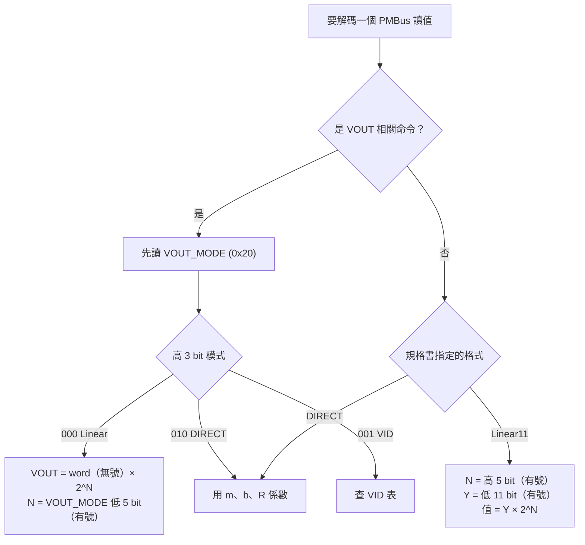

# PMBus Command 與資料解碼

> 📌 **一句話重點**：PMBus 讀回來的是**編碼過的原始值**。多數讀值用 **Linear11**（一個 word 內含 5-bit 指數＋11-bit 尾數）；輸出電壓用 **Linear16**（尾數在 word，指數在 `VOUT_MODE`）。**解碼前先確認格式，永遠不要把 raw 直接當物理量。**

## 1. 常用 Command Code

| 命令 | 碼 | 交易 | 常見格式 | 單位 |
|---|---|---|---|---|
| `VOUT_MODE` | `0x20` | Read Byte | 模式＋指數 | — |
| `STATUS_BYTE` | `0x78` | Read Byte | 位元欄位 | — |
| `STATUS_WORD` | `0x79` | Read Word | 位元欄位 | — |
| `STATUS_VOUT`／`IOUT`／`INPUT`／`TEMPERATURE`／`CML` | `0x7A`／`0x7B`／`0x7C`／`0x7D`／`0x7E` | Read Byte | 位元欄位 | — |
| `STATUS_FANS_1_2` | `0x81` | Read Byte | 位元欄位 | — |
| `READ_VIN` | `0x88` | Read Word | Linear11 | V |
| `READ_IIN` | `0x89` | Read Word | Linear11 | A |
| `READ_VOUT` | `0x8B` | Read Word | **Linear16**（依 VOUT_MODE） | V |
| `READ_IOUT` | `0x8C` | Read Word | Linear11 | A |
| `READ_TEMPERATURE_1` | `0x8D` | Read Word | Linear11 | °C |
| `READ_FAN_SPEED_1` | `0x90` | Read Word | Linear11 | RPM |
| `READ_POUT` | `0x96` | Read Word | Linear11 | W |
| `READ_PIN` | `0x97` | Read Word | Linear11 | W |
| `PMBUS_REVISION` | `0x98` | Read Byte | — | — |
| `MFR_ID`／`MFR_MODEL`／`MFR_REVISION`／`MFR_SERIAL` | `0x99`／`0x9A`／`0x9B`／`0x9E` | Block Read | ASCII | — |
| `CAPABILITY` | `0x19` | Read Byte | bit7＝支援 PEC | — |
| `CLEAR_FAULTS` 🔴 | `0x03` | Send Byte | — | 寫入類 |

> ⚠️ 命令碼來自 PMBus 規範，**但某顆 PSU 是否支援、用 Linear 還是 DIRECT、交易型態是否相同，都必須依 PSU 規格書與實測核對**。廠商自訂命令（`0xD0`–`0xFD`）每家不同。

## 2. Linear11：一個 word 裝下指數與尾數

適用：VIN、IIN、IOUT、POUT、PIN、溫度、風扇轉速等。

<div class="bits">
<span class="e">15</span><span class="e">14</span><span class="e">13</span><span class="e">12</span><span class="e">11</span><span class="m">10</span><span class="m">9</span><span class="m">8</span><span class="m">7</span><span class="m">6</span><span class="m">5</span><span class="m">4</span><span class="m">3</span><span class="m">2</span><span class="m">1</span><span class="m">0</span>
<span class="lbl" style="--n:5">N：5-bit 有號指數</span><span class="lbl" style="--n:11">Y：11-bit 有號尾數</span>
</div>

**數值 = Y × 2ᴺ**

- **N**：bit 15–11，**二補數有號**，範圍 −16 到 +15。
- **Y**：bit 10–0，**二補數有號**，範圍 −1024 到 +1023。

> 💡 **二補數（two's complement）快速換算**：n-bit 數值若最高位為 1，就把它**減去 2ⁿ**。5-bit：≥16 則減 32；11-bit：≥1024 則減 2048。

### 手算例題 1：READ_VIN = `0xF398`

```text
0xF398 = 1111 0011 1001 1000
         └─N─┘└────Y─────┘
N = 11110b = 30 → 30 − 32 = −2
Y = 011 1001 1000b = 0x398 = 920（最高位 0，為正）
VIN = 920 × 2⁻² = 920 ÷ 4 = 230.0 V
```

### 手算例題 2：READ_POUT = `0x0AEE`

```text
0x0AEE = 0000 1010 1110 1110
N = 00001b = +1
Y = 010 1110 1110b = 0x2EE = 750
POUT = 750 × 2¹ = 1500 W
```

### 手算例題 3：READ_IOUT = `0xD1F4`

```text
0xD1F4 = 1101 0001 1111 0100
N = 11010b = 26 → 26 − 32 = −6
Y = 001 1111 0100b = 0x1F4 = 500
IOUT = 500 × 2⁻⁶ = 500 ÷ 64 = 7.8125 A
```

### 手算例題 4（負尾數）：READ_TEMPERATURE_1 = `0xE7B0`

```text
0xE7B0 = 1110 0111 1011 0000
N = 11100b = 28 → 28 − 32 = −4
Y = 111 1011 0000b = 0x7B0 = 1968 → 1968 − 2048 = −80
T = −80 × 2⁻⁴ = −5.0 °C
```

> 📌 **解析度的直覺**：N 越小（越負）解析度越細但量程越小。N=−2 時一格 0.25，最大約 255.75；N=+1 時一格 2，最大 2046。所以 PSU 會隨讀值大小改變 N——**每一筆都要重新取 N，不能寫死**。

## 3. Linear16：輸出電壓專用

`READ_VOUT`（以及 `VOUT_COMMAND`、各種 VOUT 門檻）使用：

- **尾數 V**：整個 word，**16-bit 無號**（0–65535）。
- **指數 N**：來自另一個命令 **`VOUT_MODE`（0x20）** 的低 5 bit（二補數有號）。
- `VOUT_MODE` 的高 3 bit 是**模式**：`000`＝Linear、`001`＝VID、`010`＝DIRECT。

<div class="bits b8">
<span class="r">7</span><span class="r">6</span><span class="r">5</span><span class="e">4</span><span class="e">3</span><span class="e">2</span><span class="e">1</span><span class="e">0</span>
<span class="lbl" style="--n:3">模式</span><span class="lbl" style="--n:5">N：5-bit 有號指數</span>
</div>

**VOUT = V × 2ᴺ**

### 手算例題 5：VOUT_MODE = `0x17`，READ_VOUT = `0x1800`

```text
VOUT_MODE = 0x17 = 000 10111b
模式 = 000（Linear）
N = 10111b = 23 → 23 − 32 = −9
V = 0x1800 = 6144
VOUT = 6144 × 2⁻⁹ = 6144 ÷ 512 = 12.0 V
```

### 手算例題 6：VOUT_MODE = `0x18`，READ_VOUT = `0x3600`

```text
N = 11000b = 24 → 24 − 32 = −8
V = 0x3600 = 13824
VOUT = 13824 ÷ 256 = 54.0 V
```



## 4. DIRECT 格式

部分裝置（較常見於熱插拔控制器、某些 PSU）使用 DIRECT：

**X = (1 / m) × (Y × 10⁻ᴿ − b)**

- Y：讀回的 16-bit **有號**整數。
- m、b、R：**係數**，來自規格書或 `COEFFICIENTS`（0x30）命令；**每個命令可能各有一組**。

例：m = 100、b = 0、R = 0，Y = 1205 → X = 1205 ÷ 100 = 12.05。

## 5. Python 解碼程式

**🟢 可直接執行（純運算）** — 完整檔案與測試在 [`labs/pmbus_decode.py`](labs/pmbus_decode.py)、[`labs/test_pmbus_decode.py`](labs/test_pmbus_decode.py)。

```python
def _signed(value: int, bits: int) -> int:
    """把 bits 位元的無號整數解讀為二補數有號數。"""
    return value - (1 << bits) if value & (1 << (bits - 1)) else value


def linear11(word: int) -> float:
    """Linear11：高 5 bit 為有號指數 N，低 11 bit 為有號尾數 Y，值 = Y * 2^N。"""
    if not 0 <= word <= 0xFFFF:
        raise ValueError("word 必須是 0..0xFFFF")
    n = _signed(word >> 11, 5)
    y = _signed(word & 0x7FF, 11)
    return y * 2.0 ** n


def linear16(word: int, vout_mode: int) -> float:
    """Linear16：尾數為 16-bit 無號 word，指數來自 VOUT_MODE 低 5 bit（有號）。"""
    if not 0 <= word <= 0xFFFF:
        raise ValueError("word 必須是 0..0xFFFF")
    mode = (vout_mode >> 5) & 0x7
    if mode != 0:
        raise ValueError(f"VOUT_MODE 模式為 {mode:03b}，不是 Linear，不能用 Linear16 解碼")
    n = _signed(vout_mode & 0x1F, 5)
    return word * 2.0 ** n


def direct(word: int, m: int, b: int, r: int) -> float:
    """DIRECT：X = (1/m) * (Y * 10^-R - b)，Y 為 16-bit 有號。"""
    y = _signed(word, 16)
    return (y * 10.0 ** (-r) - b) / m


def word_from_bytes(low: int, high: int) -> int:
    """SMBus 低位元組先送。"""
    return (high << 8) | low
```

測試案例（與上面手算一致）：

```python
assert linear11(0xF398) == 230.0        # VIN
assert linear11(0x0AEE) == 1500.0       # POUT
assert linear11(0xD1F4) == 7.8125       # IOUT
assert linear11(0xE7B0) == -5.0         # 負溫度
assert linear16(0x1800, 0x17) == 12.0   # 12 V
assert linear16(0x3600, 0x18) == 54.0   # 54 V
assert direct(1205, m=100, b=0, r=0) == 12.05
assert word_from_bytes(0x98, 0xF3) == 0xF398
```

## 6. STATUS_BYTE／STATUS_WORD

`STATUS_WORD` 的低位元組就是 `STATUS_BYTE`。

<div class="bits">
<span class="r">15</span><span class="r">14</span><span class="r">13</span><span class="r">12</span><span class="r">11</span><span class="r">10</span><span class="r">9</span><span class="r">8</span><span class="m">7</span><span class="m">6</span><span class="m">5</span><span class="m">4</span><span class="m">3</span><span class="m">2</span><span class="m">1</span><span class="m">0</span>
<span class="lbl" style="--n:8">高位元組（僅 STATUS_WORD）</span><span class="lbl" style="--n:8">低位元組 = STATUS_BYTE</span>
</div>

| Bit | 名稱 | 意義 | 細節看哪裡 |
|---|---|---|---|
| 15 | VOUT | 輸出電壓 Fault／Warning | `STATUS_VOUT` 0x7A |
| 14 | IOUT/POUT | 輸出電流／功率 Fault／Warning | `STATUS_IOUT` 0x7B |
| 13 | INPUT | 輸入 Fault／Warning | `STATUS_INPUT` 0x7C |
| 12 | MFR_SPECIFIC | 廠商自訂 | `STATUS_MFR_SPECIFIC` 0x80 |
| 11 | POWER_GOOD# | **1 = Power Good 無效** | — |
| 10 | FANS | 風扇 Fault／Warning | `STATUS_FANS_1_2` 0x81 |
| 9 | OTHER | 其他 | `STATUS_OTHER` 0x7F |
| 8 | UNKNOWN | 未分類 | — |
| 7 | BUSY | 裝置忙碌無法回應 | — |
| 6 | OFF | **輸出未供電**（不論原因，包含正常關機） | — |
| 5 | VOUT_OV_FAULT | 輸出過壓 | `STATUS_VOUT` |
| 4 | IOUT_OC_FAULT | 輸出過流 | `STATUS_IOUT` |
| 3 | VIN_UV_FAULT | 輸入欠壓 | `STATUS_INPUT` |
| 2 | TEMPERATURE | 溫度 Fault／Warning | `STATUS_TEMPERATURE` 0x7D |
| 1 | CML | 通訊／記憶體／邏輯錯誤 | `STATUS_CML` 0x7E |
| 0 | NONE_OF_THE_ABOVE | 以上皆非的其他 Fault | — |

例：`STATUS_WORD = 0x0848`

```text
0x0848 = 0000 1000 0100 1000
bit 11 POWER_GOOD# = 1 → Power Good 無效
bit 6  OFF         = 1 → 輸出關閉
bit 3  VIN_UV_FAULT= 1 → 輸入欠壓
解讀：輸入電壓過低（或 AC 遺失），輸出已關閉。
```

```python
STATUS_WORD_BITS = {
    15: "VOUT", 14: "IOUT/POUT", 13: "INPUT", 12: "MFR_SPECIFIC",
    11: "POWER_GOOD#", 10: "FANS", 9: "OTHER", 8: "UNKNOWN",
    7: "BUSY", 6: "OFF", 5: "VOUT_OV_FAULT", 4: "IOUT_OC_FAULT",
    3: "VIN_UV_FAULT", 2: "TEMPERATURE", 1: "CML", 0: "NONE_OF_THE_ABOVE",
}

def decode_status_word(word: int) -> list[str]:
    return [name for bit, name in sorted(STATUS_WORD_BITS.items(), reverse=True) if word >> bit & 1]

print(decode_status_word(0x0848))   # ['POWER_GOOD#', 'OFF', 'VIN_UV_FAULT']
```

重要行為：

- **Fault 位元是「栓鎖」的**：條件消失後仍保持，直到 `CLEAR_FAULTS`、重新上電或被寫 1 清除（依版本）。所以讀到 Fault 不代表「現在」還在發生。
- **Warning vs Fault**：Warning 只通知；Fault 通常伴隨保護動作（關斷、重試）。
- **CML bit** 常是因為有人送了不支援的命令或 PEC 錯誤——在匯流排上亂試命令會留下這個痕跡。
- `STATUS_MFR_SPECIFIC` 與 OEM 擴充每家不同，**需查 PSU 規格**。

## 7. PMBus 讀值 vs Redfish 顯示值為何不同

| 原因 | 說明 |
|---|---|
| **更新頻率** | PSU 內部每隔數十到數百 ms 更新；BMC 每 1 到數秒輪詢一次；你讀 Redfish 的時間又不同 |
| **快取** | Redfish 回傳的是 BMC 上次輪詢的結果，可能是幾秒前的值 |
| **平均／濾波** | PSU 或 BMC 可能做移動平均 |
| **四捨五入／解析度** | Linear11 解析度有限（如 N=+1 時一格 2 W）；BMC 可能取整數 |
| **校正** | PSU 內部量測有誤差（PMBus 讀值精度通常為 ±數 %），BMC 可能再做修正 |
| **感測位置不同** | PSU 內量到的輸出 vs 主機板端量到的（中間有線損／背板壓降） |
| **定義不同** | 單顆 PSU 功率 vs 系統總功率；輸入功率 vs 輸出功率（差一個效率） |

> ✅ 驗證時：先定義**比較對象**（哪個點、哪個量）、**容差**、**取樣方式**（穩態、多筆平均），再下結論。

## 8. 常見誤解

| 誤解 | 正確觀念 |
|---|---|
| `i2cget` 回來的值就是電壓 | 是編碼後的 raw，要依格式解碼 |
| READ_VOUT 用 Linear11 解 | VOUT 用 Linear16＋VOUT_MODE（除非規格另有說明） |
| N 是固定的，可以寫死 | Linear11 的 N 會隨量值變化；VOUT_MODE 也應實際讀取 |
| Linear16 的尾數有號 | 無號；有號的是指數 |
| STATUS 有 Fault 位元＝現在正在故障 | 可能是栓鎖住的歷史事件 |
| 所有 PSU 的命令集相同 | 各家實作子集不同，並有 OEM 命令 |

## 9. 練習題

**Q1.** 解碼 Linear11：`0xF3C8`（提示：READ_VIN）。

<details><summary>看解答</summary>

`1111 0011 1100 1000`：N=`11110`=−2；Y=`011 1100 1000`=0x3C8=968；值=968÷4=**242.0 V**。

</details>

**Q2.** VOUT_MODE=`0x17`、READ_VOUT=`0x1866`，輸出電壓？

<details><summary>看解答</summary>

N=−9；V=0x1866=6246；6246÷512=**12.199 V**（約 12.2 V）。

</details>

**Q3.** 為什麼 Linear16 需要另外讀 VOUT_MODE？

<details><summary>看解答</summary>

Linear16 把整個 16-bit 都用於尾數以獲得高解析度，指數則放在 `VOUT_MODE` 的低 5 bit，且對所有 VOUT 相關命令共用。不讀 VOUT_MODE 就不知道比例。

</details>

**Q4.** `STATUS_WORD = 0x2008` 代表什麼？

<details><summary>看解答</summary>

bit 13（INPUT）＝1、bit 3（VIN_UV_FAULT）＝1：輸入端異常，具體為輸入欠壓。應再讀 `STATUS_INPUT`（0x7C）看細節。

</details>

**Q5.** 把 1200 W 編碼成 Linear11，若選 N=+1，word 是多少？

<details><summary>看解答</summary>

Y=1200÷2=600=0x258=`010 0101 1000`；N=`00001`；組合 `0000 1010 0101 1000`=**`0x0A58`**。

</details>

**🔧 動手練習**（🟢 純 Python）：執行 `python labs/test_pmbus_decode.py`（或 `pytest labs/`），再自己加三個測試案例：一個負指數、一個負尾數、一個 VOUT_MODE 非 Linear 應丟出例外的情況。

---

## 🧩 整合題（第 10–12 章）

規格書寫「PMBus Address: B0h」。你在 BMC 的 Linux 上想讀輸出電壓，請寫出完整步驟（含要確認的事項、指令、解碼），並說明邏輯分析儀上會看到的 byte 序列（假設 VOUT_MODE=0x17、輸出 12.0 V、無 PEC）。

<details><summary>看解答</summary>

**確認**：設備為授權測試機；`0xB0` > `0x7F` 故為 8-bit 表示 → 7-bit 位址 `0x58`；用 `i2cdetect -l` 與平台文件確認 PSU 所在的 bus 編號（含 MUX 通道）；規格書確認支援 `VOUT_MODE` 與 `READ_VOUT` 且為 Linear 模式。

**指令**（唯讀）：

```bash
i2cget -y <BUS> 0x58 0x20 b     # → 0x17
i2cget -y <BUS> 0x58 0x8B w     # → 0x1800
```

**解碼**：N = 0x17 低 5 bit = −9；VOUT = 0x1800 × 2⁻⁹ = 6144 ÷ 512 = 12.0 V。

**線上 bytes**（READ_VOUT）：`S, 0xB0, A, 0x8B, A, Sr, 0xB1, A, 0x00, A, 0x18, N, P`——位址 byte 為 `0xB0`（寫）與 `0xB1`（讀），資料低位元組 `0x00` 先、高位元組 `0x18` 後。

</details>
