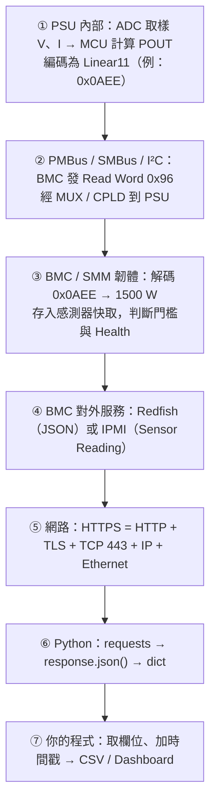
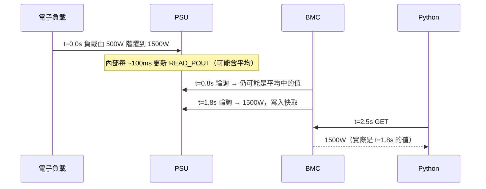
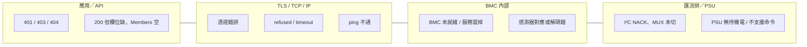
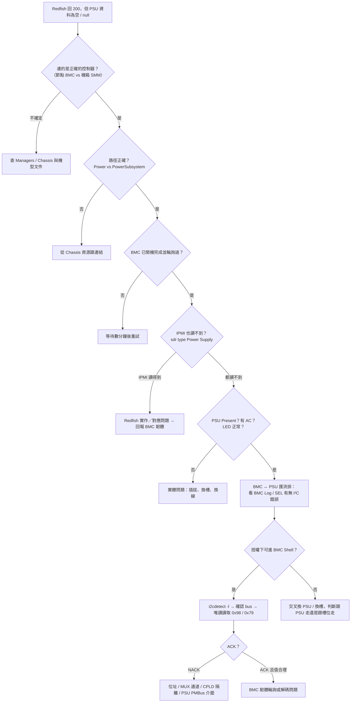

# 從 PSU 到 Python 的端到端資料流

> 📌 **一句話重點**：一個「PSU1 輸出功率 = 1500 W」的數字，從 PSU 內部 ADC 到你的 CSV，要經過 **7 個以上的環節**。每個環節都有自己的更新週期與可能的故障點——Debug 就是找出斷在哪一環。

## 1. 以 `PSU1 READ_POUT` 為例的完整路徑



| 環節 | 資料長什麼樣 | 誰負責 | 對應章節 |
|---|---|---|---|
| ① PSU 內部 | 類比量 → ADC 計數 → Linear11 word | PSU 韌體 | 12 |
| ② 匯流排 | `S D0 96 Sr D1 EE 0A P`（示意） | I²C／SMBus／PMBus | 10、11 |
| ③ BMC 解碼 | `1500.0`（浮點／整數） | BMC／SMM 韌體 | 1 |
| ④ 對外呈現 | `"PowerOutputWatts": 1500` | Redfish／IPMI 服務 | 2、8、9 |
| ⑤ 網路傳輸 | 加密的 TCP 封包 | TLS／TCP／IP | 3–5 |
| ⑥ 解析 | Python `dict` | requests／json | 7、8 |
| ⑦ 輸出 | CSV 一列 | 你的程式 | 16 |

## 2. 解碼發生在哪裡？

- **走 Redfish／IPMI**：解碼在 **BMC（環節 ③）** 完成，你拿到的已經是工程單位（W、V、A）。你**看不到** raw word。
- **直接用 i2c-tools**：你站在環節 ② 的位置，拿到 raw word，**解碼由你負責**（第 12 章）。

> ⚠️ 因此「Redfish 的值不對」可能是 PSU 回報錯（①）、傳輸錯（②）、BMC 解碼／對應錯（③）、或呈現時單位／欄位用錯（④）。要分清楚得有第二個觀測點：raw PMBus 值或外部儀器。

## 3. 時間軸：為什麼數字會「慢半拍」


<p class="figcap">時間數值純為示意；實際週期依 PSU 與 BMC 韌體而定，需依實機驗證</p>

| 延遲來源 | 典型量級（示意） |
|---|---|
| PSU 內部更新／平均 | 數十 ms – 1 s |
| BMC 輪詢週期 | 1 – 數秒（PSU 多時更長） |
| Redfish 請求往返 | 數十 – 數百 ms |
| 你的取樣週期 | 自訂 |

實務建議：

- 取樣週期**不要短於 BMC 輪詢週期**——只會讀到重複值並增加 BMC 負擔。
- 驗證動態行為（暫態、保護動作時間）**不能靠 Redfish**，要用示波器／功率分析儀。
- 記錄時間戳時註明是「**讀取時間**」而不是「量測時間」。

## 4. 層級與故障點對照



| 症狀 | 最可能的層 | 第一個檢查動作 |
|---|---|---|
| ping／TCP 都不通 | 實體／IP | Link、IP 設定、是否接到管理埠 |
| TCP 通，TLS 失敗 | TLS | 憑證、TLS 版本、時間是否正確 |
| HTTP 401／403 | 認證／授權 | 帳密、Token、角色 |
| HTTP 404 | API 路徑 | 從 Service Root 重新導覽 |
| 200，PSU 集合為空 | BMC／平台架構 | 是否該問 SMM；BMC 是否剛開機 |
| 200，PSU 在但讀值 `null`／0 | BMC ↔ PSU | PSU 是否 Present、有無 AC、BMC Log 是否有 I²C 錯誤 |
| 讀值存在但明顯錯誤 | 解碼／對應 | 與 raw PMBus 或儀器比對 |
| 讀值偶爾跳動／掉值 | 匯流排競爭／雜訊 | 是否有人同時用 i2c-tools；看 PEC 錯誤、CML bit |

## 5. 逐層定位流程：「BMC 連線正常但 PSU Telemetry 為空」



> ✅ **交換法（Swap Test）**是硬體 Debug 的利器：把 PSU1 與 PSU2 對調，問題「跟著 PSU 走」→ PSU 問題；「留在槽位」→ 背板／MUX／BMC 端問題。

## 6. 案例：Lenovo 4-PSU 機箱＋SMM3＋FirmwareInventory

> ⚠️ 以下為**情境案例**，項目名稱（例如 `PCS1`–`PCS4`）、路徑與欄位**依硬體平台與韌體版本而異**，不可視為通則；請以實機回應與 Lenovo 官方文件為準。

情境：一台多節點機箱，4 顆共用 PSU 由機箱管理模組（SMM3）管理。想盤點 4 顆 PSU 的韌體版本。

1. **確認對象**：PSU 屬於機箱 → 目標是 SMM 的管理 IP，而不是某個節點的 XCC。
2. **導覽**：`GET /redfish/v1/` → `UpdateService` → `FirmwareInventory` → `Members`。
3. **辨識項目**：逐一 GET 成員，從 `Name`／`Id`／`Description` 找出代表 PSU 的項目（此平台上可能以 `PCS1`–`PCS4` 之類命名，需依實機驗證），記下 `Version`、`Updateable`。
4. **交叉核對**：與 Chassis 下 PowerSupplies 的 `FirmwareVersion`、Web UI 顯示值、PSU 標籤比對。
5. **異常處理**：少一筆 → 該 PSU 是否在位／有 AC；版本為空 → BMC 尚未讀到或 PSU 處於特殊模式。

模擬回應（教學用）：

```json
{
  "Id": "PCS1",
  "Name": "Power Supply 1 Firmware",
  "Version": "00.51",
  "Updateable": true,
  "Status": { "State": "Enabled", "Health": "OK" }
}
```

## 7. 設計一個監控系統時的建議

| 設計點 | 建議 |
|---|---|
| 探索 | 啟動時從 Service Root 探索路徑並快取，不寫死 |
| 取樣 | 週期 ≥ BMC 輪詢週期；所有請求有 timeout |
| 連線 | 重用 `requests.Session` 與 Redfish Session；結束登出 |
| 資料 | 原始 JSON 另存一份，方便事後追查 |
| 缺值 | 區分「未提供／null／0／讀取失敗」 |
| 時間 | 用 UTC 時間戳；註明為讀取時間 |
| 安全 | 憑證驗證開啟；密碼與 Token 不落地、不進 Log |
| 負載 | 多台機器時限制並行數，避免拖垮 BMC |

## 8. 練習題

**Q1.** 透過 Redfish 取得 PSU 功率時，PMBus 原始值在哪裡被解碼？

<details><summary>看解答</summary>

在 BMC／SMM 韌體內。它以 PMBus 讀到 raw word，依 Linear11 等格式解碼成工程單位後存入快取，再由 Redfish 服務放進 JSON。

</details>

**Q2.** 為什麼用 Redfish 驗證 PSU 暫態響應不合適？

<details><summary>看解答</summary>

Redfish 的值是 BMC 週期性輪詢並快取的結果，更新週期為秒級，且可能經過平均；暫態發生在毫秒或更短的時間尺度，必須用示波器等儀器。

</details>

**Q3.** Redfish 與 IPMI 都讀不到某顆 PSU，但 PSU 的 LED 正常，下一步？

<details><summary>看解答</summary>

問題較可能在 BMC ↔ PSU 的通訊路徑。查 BMC Log／SEL 是否有 I²C 錯誤；在授權下以唯讀方式確認 PSU 位址是否 ACK；並用交換法判斷問題跟著 PSU 還是槽位。

</details>

**Q4.** 交換法能區分哪兩類問題？

<details><summary>看解答</summary>

「跟著 PSU 移動」代表 PSU 本身（PMBus 介面、韌體）有問題；「留在原槽位」代表系統側（背板、連接器、MUX、CPLD、BMC 設定）有問題。

</details>

**Q5.** 監控程式每 100 ms 讀一次 Redfish 功率有什麼問題？

<details><summary>看解答</summary>

遠快於 BMC 輪詢週期，讀到的大多是重複值；同時增加 BMC 負載，可能導致回應變慢、Session 耗盡或 503。

</details>

**🔧 動手練習**：畫出你實際負責平台的端到端資料流圖，標上每個環節的「更新週期（已知或待驗證）」與「我能在這裡觀測到什麼」。
