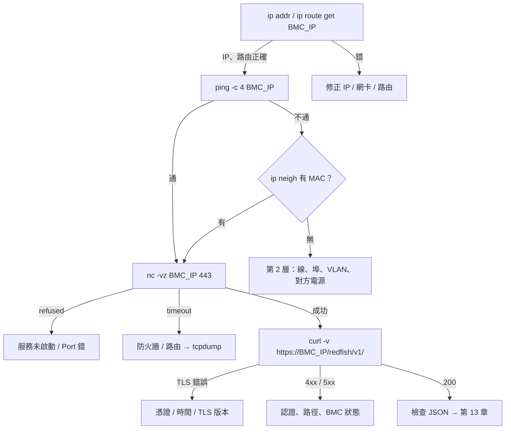

# Linux 網路診斷與常用指令

> 📌 **一句話重點**：診斷永遠**由下往上**：先確認自己的 IP／路由 → ping → TCP Port → TLS → HTTP 狀態碼 → JSON 內容。每個指令對應一層，**看得到上層的回應，就代表下層都通了**。

## 1. 指令與層級對照

| 層 | 指令 | 回答的問題 | 權限 |
|---|---|---|---|
| 2 | `ip link`、`ip neigh` | 網卡 UP 嗎？ARP 解析到對方 MAC 嗎？ | 一般 |
| 3 | `ip addr`、`ip route`、`ping` | 我的 IP／遮罩？封包從哪張網卡出去？對方可達嗎？ | 一般 |
| 4 | `nc -vz`、`ss -tulpen` | 對方的 Port 有開嗎？我這台有哪些服務在聽？ | `ss -p` 看行程名需 root |
| 5–7 | `curl -v` | TLS 握手、HTTP 狀態碼、Header | 一般 |
| 全部 | `tcpdump` | 線上實際跑了什麼封包？ | **root** |
| 系統 | `journalctl`、`systemctl status` | 服務有沒有起來、有什麼錯誤？ | 部分需 root |

## 2. 逐一拆解

以下皆為 **🟢 唯讀、可直接執行（需填參數）**，除非另外標示。

### 2.1 `ip addr` — 我是誰

```bash
ip addr            # 可簡寫 ip a
ip -br addr        # 精簡格式
```

```text
2: enp3s0: <BROADCAST,MULTICAST,UP,LOWER_UP> mtu 1500 ...
    link/ether 00:11:22:33:44:55 brd ff:ff:ff:ff:ff:ff
    inet 192.168.70.50/24 brd 192.168.70.255 scope global enp3s0
```

- `UP,LOWER_UP`：介面啟用且**實體有連線**；只有 `UP` 沒有 `LOWER_UP`（或顯示 `NO-CARRIER`）＝線沒接好。
- `inet 192.168.70.50/24`：IP 與遮罩。**沒有這行就是沒 IP。**

### 2.2 `ip route` — 封包往哪走

```bash
ip route
ip route get <BMC_IP>     # 最實用：直接問「到這個 IP 會走哪張網卡、用哪個來源 IP」
```

```text
192.168.70.100 dev enp3s0 src 192.168.70.50 uid 1000
```

若出現 `via 10.0.0.1 dev wlan0`，代表封包被送去預設閘道（走錯網卡）——同網段直連的 BMC 不應該有 `via`。

### 2.3 `ping` — 第 3 層可達性

```bash
ping -c 4 <BMC_IP>
```

| 輸出 | 意義 |
|---|---|
| `64 bytes from ... time=0.4 ms` | 可達 |
| `Destination Host Unreachable`（來自自己的 IP） | **ARP 失敗**：同網段但對方不在／線路問題 |
| 沒有任何回應、100% packet loss | 路由不通、防火牆擋 ICMP、或對方關閉 ping 回應 |
| `Network is unreachable` | 本機沒有通往該網段的路由（IP 沒設） |

> ⚠️ ping 不通**不等於** HTTPS 不通（ICMP 可能被擋）；繼續用 `nc` 測 Port。

### 2.4 `nc -vz` — TCP Port 測試

```bash
nc -vz <BMC_IP> 443       # -v 詳細、-z 只測連線不送資料
nc -vz -w 3 <BMC_IP> 22   # -w 3：逾時 3 秒
```

| 輸出 | 意義 |
|---|---|
| `succeeded!`／`open` | 三向交握成功，Port 有服務 |
| `Connection refused` | 主機可達，但該 Port 沒有服務（收到 RST） |
| `timed out` | 無回應：防火牆丟包或主機不可達 |

> ⚠️ **UDP（623、69）不能這樣測**。`nc -vzu` 的「成功」只表示沒收到 ICMP port unreachable，不代表服務正常。UDP 623 用 `ipmitool ... mc info` 驗證；UDP 69 用 TFTP 用戶端實際抓一個檔。

### 2.5 `ss -tulpen` — 我這台在聽什麼

架 TFTP／模擬伺服器時用來確認服務有起來：

```bash
sudo ss -tulpen
```

| 旗標 | 意義 |
|---|---|
| `-t`／`-u` | TCP／UDP |
| `-l` | 只列 LISTEN 中的 |
| `-p` | 顯示行程 |
| `-e` | 延伸資訊 |
| `-n` | 不解析名稱（顯示數字 Port） |

```text
Netid State  Local Address:Port  Process
udp   UNCONN 0.0.0.0:69          users:(("in.tftpd",pid=812,fd=4))
tcp   LISTEN 127.0.0.1:8443      users:(("python3",pid=2231,fd=3))
```

- `0.0.0.0:69`＝所有介面都聽；`127.0.0.1:8443`＝**只有本機**連得到，外部設備連不到。

### 2.6 `curl -v` — TLS 與 HTTP

```bash
curl -v --max-time 10 --cacert <CA_CERT_PATH> 'https://<BMC_IP>/redfish/v1/' -o /dev/null
```

輸出判讀（`*` 開頭是 curl 的說明、`>` 是送出、`<` 是收到）：

```text
*   Trying 192.168.70.100:443...
* Connected to 192.168.70.100 (192.168.70.100) port 443      ← TCP 成功
* TLSv1.3 (OUT), TLS handshake, Client hello (1):
* SSL connection using TLSv1.3 / TLS_AES_256_GCM_SHA384      ← TLS 成功
* Server certificate:
*  subject: CN=...
*  issuer: CN=...                                            ← subject = issuer 即自簽
> GET /redfish/v1/ HTTP/1.1                                  ← 送出的請求
< HTTP/1.1 200 OK                                            ← 狀態碼
< Content-Type: application/json
```

### 2.7 `journalctl`／`systemctl` — 服務日誌

```bash
systemctl status tftpd-hpa          # 服務狀態（服務名稱依發行版而異）
journalctl -u tftpd-hpa -n 50       # 最近 50 行
journalctl -f                       # 即時追蹤
journalctl -k | grep -i i2c         # 核心訊息中的 I²C 錯誤
```

### 2.8 `tcpdump` — 終極真相（🟡 需 root）

```bash
sudo tcpdump -ni enp3s0 host <BMC_IP>                    # 與 BMC 的所有封包
sudo tcpdump -ni enp3s0 host <BMC_IP> and tcp port 443   # 只看 HTTPS
sudo tcpdump -ni enp3s0 udp port 623                     # IPMI
sudo tcpdump -ni enp3s0 udp and host <BMC_IP>            # TFTP（含 TID 臨時埠）
sudo tcpdump -ni enp3s0 arp                              # ARP
```

`-n` 不解析名稱；`-i` 指定介面；`-w file.pcap` 存檔給 Wireshark。

TCP 旗標判讀：

| 看到 | 意義 |
|---|---|
| `[S]` → `[S.]` → `[.]` | SYN → SYN-ACK → ACK：交握成功 |
| `[S]` 重複多次，沒有回應 | 封包被丟棄（timeout） |
| `[S]` → `[R.]` | 對方回 RST（refused） |
| 只有 ARP request 沒有 reply | 第 2 層不通 |

> ⚠️ 抓包檔可能包含未加密的敏感資料（例如 IPMI 1.5、HTTP、TFTP 內容），保存與分享要小心。

## 3. 固定 IP、同子網路、路由與防火牆

### 3.1 暫時設定固定 IP（🟡 會改變本機網路設定，重開機後消失）

```bash
sudo ip addr add 192.168.70.50/24 dev enp3s0
sudo ip link set enp3s0 up
# 還原
sudo ip addr del 192.168.70.50/24 dev enp3s0
```

永久設定依發行版而異：Ubuntu 用 netplan／NetworkManager（`nmcli`）；RHEL／CentOS 用 `nmcli` 或 `/etc/sysconfig/network-scripts/`。

### 3.2 防火牆

| 發行版 | 工具 | 查看 |
|---|---|---|
| Ubuntu | `ufw` | `sudo ufw status` |
| RHEL／CentOS | `firewalld` | `sudo firewall-cmd --list-all` |
| 通用 | `nftables`／`iptables` | `sudo nft list ruleset` |

注意方向：你**連出去**到 BMC 的 443 通常不受本機防火牆影響；BMC **連進來**抓 TFTP 檔（UDP 69）才需要在你的機器上開放。

### 3.3 Windows／WSL／Linux 差異

| | 原生 Linux | Windows | WSL2（預設 NAT） |
|---|---|---|---|
| 看 IP | `ip addr` | `ipconfig` | `ip addr` 看到的是**虛擬網段**（172.x），不是 Windows 的實體 IP |
| 路由 | `ip route` | `route print` | 經 Windows 轉送 |
| 測 Port | `nc -vz` | `Test-NetConnection <IP> -Port 443` | `nc -vz` |
| ping | `ping -c 4` | `ping -n 4` | 同 Linux |
| 連**出去**到 BMC | ✅ | ✅ | ✅ 通常可以（經 NAT） |
| 外部設備連**進來** | ✅ | 需開 Windows 防火牆 | ❌ **預設連不到**：BMC 看不到 WSL 的 172.x 位址 |

> ⚠️ 在 WSL2 裡跑 `curl`／Python 打 Redfish 通常沒問題；但在 WSL2 裡**架 TFTP 伺服器給 BMC 抓檔**，預設 NAT 模式下幾乎一定失敗。解法見 [第 15 章](#/doc/ch15)（Mirrored Networking 或改用原生 Linux／Windows 上的 TFTP 服務）。

## 4. 排查矩陣

| 症狀 | 層 | 可能原因 | 下一步 |
|---|---|---|---|
| `ping`：Host Unreachable | 2 | 線沒接／接錯埠、VLAN、BMC 未上電、IP 打錯 | `ip link`、`ip neigh`、看 Link 燈 |
| `ping`：Network is unreachable | 3 | 本機沒有該網段的 IP／路由 | `ip addr`、`ip route get` |
| `ping` 100% loss 但 ARP 有 MAC | 3 | 對方關閉 ICMP 或防火牆 | 直接測 `nc -vz ... 443` |
| TCP `Connection refused` | 4 | 服務沒起來、Port 錯、BMC 還在開機、HTTPS 被停用 | 等待；確認 Port；Web UI 是否可開 |
| TCP `timed out` | 3–4 | 防火牆、路由、IP 衝突 | `tcpdump` 看 SYN 有沒有回應 |
| `SSL certificate problem` | TLS | 自簽憑證、CA 未信任、主機名稱不符、憑證過期、**本機時間錯誤** | `--cacert`；檢查 `date`；實驗環境暫用 `-k` |
| `SSL routines ... unsupported protocol` | TLS | BMC 只支援舊版 TLS 或舊加密套件 | 更新 BMC 韌體；確認 TLS 設定 |
| HTTP 401 | 認證 | 帳密錯、Token 過期、帳號鎖定 | 重新登入；確認帳號狀態 |
| HTTP 403 | 授權 | 角色權限不足 | 換帳號／調整角色 |
| HTTP 404 | API | 路徑錯、資源不存在於此平台 | 從 Service Root 導覽 |
| HTTP 503 | 服務 | BMC 忙碌、剛開機、Session 滿 | 等待重試；清理 Session |
| HTTP 200 但缺欄位／`Members` 空 | 資料 | 平台不提供、BMC 未盤點完、連錯控制器 | 第 13 章流程 |
| IPMI `Unable to establish ... session` | UDP 623／認證 | IPMI over LAN 未啟用、帳密、Cipher Suite | `-vv`；`tcpdump udp port 623` |
| I²C `Read failed`（NACK） | 匯流排 | 位址（7／8-bit）、bus 編號、MUX、PSU 無電、不支援命令 | 第 11 章 |



## 5. 常見誤解

| 誤解 | 正確觀念 |
|---|---|
| ping 不通就什麼都不用試了 | ICMP 可能被擋，TCP 仍可能通 |
| `nc -vzu` 成功代表 UDP 服務正常 | UDP 無交握，需用實際協定驗證 |
| 憑證錯誤一定是 BMC 的問題 | 本機時間錯誤也會讓有效憑證被判定為過期／尚未生效 |
| WSL 的 IP 就是電腦的 IP | WSL2 NAT 模式是獨立虛擬網段 |
| 服務有在跑，外面就連得到 | 要看它聽在 `0.0.0.0` 還是 `127.0.0.1`，以及防火牆 |

## 6. 練習題

**Q1.** `ip route get <BMC_IP>` 的輸出出現 `via`，代表什麼？

<details><summary>看解答</summary>

封包會先送到閘道再轉送，代表本機不認為 BMC 在直連的子網路內。若實際是直連，通常是本機 IP／遮罩設定錯或走錯網卡。

</details>

**Q2.** ping 顯示 `Destination Host Unreachable`，來源是自己的 IP，問題在哪一層？

<details><summary>看解答</summary>

第 2 層：ARP 解析不到對方 MAC（線路、VLAN、對方未上電或 IP 不正確）。

</details>

**Q3.** 如何確認本機的 TFTP 服務有在 UDP 69 聽，且外部連得到？

<details><summary>看解答</summary>

`sudo ss -ulpn | grep ':69'` 確認有行程在聽且位址是 `0.0.0.0`（或對外的 IP）而非 `127.0.0.1`；檢查防火牆規則；再從另一台機器用 TFTP 用戶端實際下載測試。

</details>

**Q4.** tcpdump 看到本機連續送出 `[S]` 卻沒有任何回應，代表什麼？

<details><summary>看解答</summary>

SYN 沒被回覆——封包在途中被丟棄（防火牆）或對方不存在／路由不通，對應 `timed out`。若對方回 `[R.]` 則是 refused。

</details>

**Q5.** `curl` 回報憑證「尚未生效（not yet valid）」，但 BMC 憑證看起來正常，可能原因？

<details><summary>看解答</summary>

本機或 BMC 的系統時間錯誤（例如 BMC 電池沒電回到預設年份、測試機未校時），使憑證的有效期判斷失準。

</details>

**🔧 動手練習**（🟢 唯讀）：把第 4 節的流程圖對一台可達的設備實際走一遍，每一步貼上指令與輸出；再對一個不存在的 IP 走一遍，記錄每個指令的失敗訊息。
