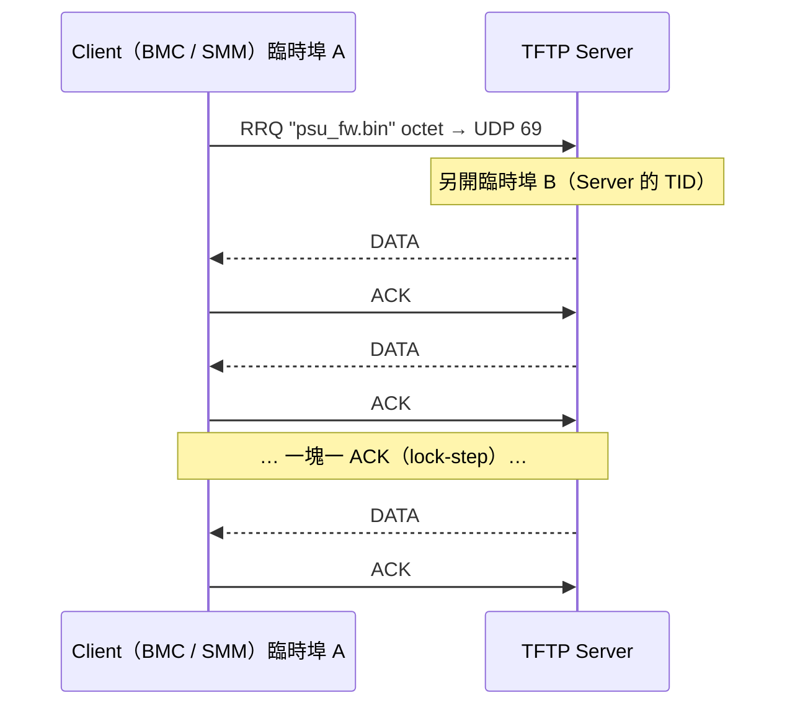
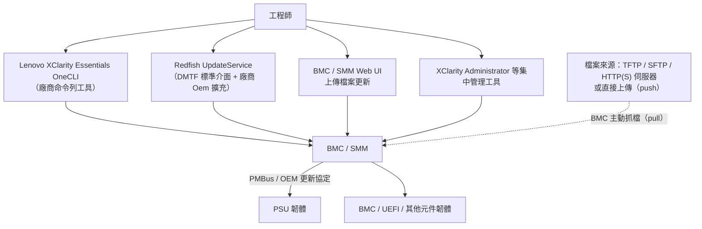
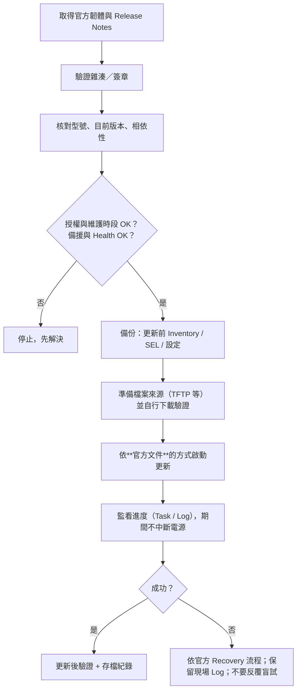

# TFTP、OneCLI 與 Firmware Update

> 🔴 **本章為進階內容，韌體更新是高風險操作。** 更新錯誤的映像檔或在更新中斷電，可能讓 PSU／BMC 無法開機（變磚）。本章只講**原理、環境準備與安全檢查**；**實際更新命令一律以該機型的官方文件為準，本筆記不提供、也不應憑空拼湊 OneCLI 或 OEM 參數。**

## 1. TFTP 是什麼

**TFTP（Trivial File Transfer Protocol，RFC 1350）** 是極簡的檔案傳輸協定：

- 走 **UDP**；初始請求送到 **port 69**。
- **沒有認證、沒有加密、不能列目錄**——只能「給我這個檔名」或「收下這個檔」。
- 實作很小，適合 Bootloader、BMC 這類嵌入式環境抓韌體。

| Opcode | 封包 | 用途 |
|---|---|---|
| 1 | **RRQ** | Read Request：我要下載檔案 |
| 2 | **WRQ** | Write Request：我要上傳檔案 |
| 3 | **DATA** | 資料塊（含區塊編號；預設每塊 512 bytes） |
| 4 | **ACK** | 確認收到第 n 塊 |
| 5 | **ERROR** | 錯誤（File not found、Access violation…） |



重點：

- **誰是 Server？** 韌體更新時，**你的 PC／Linux 是 TFTP Server**，BMC／SMM 是 Client 來抓檔。方向和 Redfish（BMC 是 server）相反。
- **TID**：只有 RRQ 送到 69；之後 Server 用**新的臨時埠**回覆，雙方以這對埠（TID）通訊（[第 4 章](#/doc/ch04)）。
- **可靠性自己做**：每塊都要 ACK，逾時重傳。
- **結束判斷**：收到小於區塊大小的 DATA。檔案大小恰為 512 的倍數時，最後會多送一個 0 byte 的 DATA。
- 傳輸模式用 `octet`（二進位）；`netascii` 會轉換換行，**傳韌體絕不能用**。

> ⚠️ **安全**：TFTP 無認證無加密，任何能連到該埠的人都能抓走 TFTP 根目錄下的檔案。只在隔離的實驗網路使用；用完關閉服務；目錄內不放機敏檔案。

## 2. 架設 TFTP 伺服器

**先查版本再操作**（🟢 唯讀）：

```bash
cat /etc/os-release
```

| | Ubuntu／Debian | CentOS 7.9／RHEL 7 | RHEL 8／9 |
|---|---|---|---|
| 套件 | `tftpd-hpa` | `tftp-server`（常搭配 `xinetd`） | `tftp-server` |
| 啟動方式 | `tftpd-hpa.service` | `xinetd` 管理（`/etc/xinetd.d/tftp`，`disable = no`）或 `tftp.socket` | systemd **`tftp.socket`**（socket activation） |
| 設定檔 | `/etc/default/tftpd-hpa` | `/etc/xinetd.d/tftp` | `systemctl edit tftp.service` 覆寫 `ExecStart` |
| 預設根目錄 | `/srv/tftp`（舊版 `/var/lib/tftpboot`） | `/var/lib/tftpboot` | `/var/lib/tftpboot` |
| 防火牆 | `ufw allow 69/udp` | `firewall-cmd --add-service=tftp` | 同左 |
| SELinux | 通常無 | 檔案需正確 context（`restorecon -Rv /var/lib/tftpboot`） | 同左 |
| 用戶端 | `tftp-hpa`／`curl` | `tftp` | `tftp`／`curl` |

> ⚠️ 上表為常見預設；不同小版本可能有差異，**以實際系統的套件說明（`man in.tftpd`、`rpm -ql tftp-server`）為準**。

### 2.1 Ubuntu 範例（🟡 會安裝套件並開啟網路服務）

```bash
sudo apt install tftpd-hpa
cat /etc/default/tftpd-hpa
```

```text
TFTP_USERNAME="tftp"
TFTP_DIRECTORY="/srv/tftp"
TFTP_ADDRESS=":69"
TFTP_OPTIONS="--secure"
```

- `--secure`：把根目錄 chroot，Client 請求的檔名都相對於 `TFTP_DIRECTORY`。
- 允許上傳才需要 `--create`（**預設不要開**）。

```bash
sudo cp <FIRMWARE_FILE> /srv/tftp/
sudo chmod 644 /srv/tftp/<FIRMWARE_FILE>      # 服務帳號要能讀
sudo systemctl restart tftpd-hpa
systemctl status tftpd-hpa
sudo ss -ulpn | grep ':69'                    # 確認在聽
```

### 2.2 驗證「設備抓得到」之前，先自己抓抓看

**🟢 可執行（從另一台機器或本機測試）**

```bash
cd /tmp
curl -o test.bin tftp://<TFTP_SERVER_IP>/<FIRMWARE_FILE>
sha256sum test.bin /srv/tftp/<FIRMWARE_FILE>     # 兩個雜湊必須相同
```

從**另一台**機器測試才能同時驗證防火牆與網路路徑；只在本機測 `127.0.0.1` 不夠。

設備端抓檔時即時觀察：

```bash
sudo tcpdump -ni <IFACE> udp and host <BMC_IP>
journalctl -u tftpd-hpa -f
```

### 2.3 常見失敗

| 症狀 | 原因 |
|---|---|
| `File not found` | 檔名大小寫、路徑不對（`--secure` 下不要帶根目錄前綴） |
| `Access violation`／`Permission denied` | 檔案權限、SELinux context |
| 逾時，tcpdump 看得到 RRQ 進來但沒有 DATA 出去 | 服務沒起來／聽錯介面 |
| 逾時，看得到 DATA 出去但沒有 ACK 回來 | 回程被防火牆擋（TID 臨時埠）、路由不對稱 |
| tcpdump 完全沒看到 RRQ | 設備到不了你的 IP：IP 填錯、不同網段、WSL NAT |
| 傳到一半失敗 | 大檔超過 65535 塊而未協商 blksize／不支援區塊編號回捲；網路掉包 |

## 3. WSL 的網路陷阱

| WSL2 網路模式 | 行為 | 架 TFTP 給 BMC 抓檔 |
|---|---|---|
| **NAT（預設）** | WSL 有自己的虛擬網段（如 `172.x.x.x`），對外經 Windows 轉送 | ❌ BMC 連不到 172.x；UDP 的埠轉送也不像 TCP 那樣可用 `netsh portproxy` 處理 |
| **Mirrored**（Windows 11 22H2 以上，在 `%UserProfile%\.wslconfig` 設 `networkingMode=mirrored`） | WSL 與 Windows 共用網路介面與 IP | ⚠️ 較可行，但仍需開 **Windows 防火牆／Hyper-V 防火牆**的 UDP 69 入站；行為依 Windows 版本而異，需實測 |

```ini
# %UserProfile%\.wslconfig （修改後需 wsl --shutdown 重啟）
[wsl2]
networkingMode=mirrored
```

要分清楚三個 IP：

| IP | 在哪看 | 給 BMC 填哪一個？ |
|---|---|---|
| Windows 實體網卡 IP（如 `192.168.70.50`） | `ipconfig` | ✅ **這個**（BMC 只看得到實體網路） |
| WSL 內的 IP（NAT 模式 `172.x`） | WSL 內 `ip addr` | ❌ |
| `127.0.0.1` | — | ❌ 只代表「自己」 |

> ✅ **最省事的做法**：需要讓設備連進來的服務（TFTP／HTTP 檔案伺服器），用**原生 Linux 機器**或直接在 **Windows 上跑 TFTP 伺服器程式**，不要放在 NAT 模式的 WSL2 裡。

## 4. 韌體更新的幾種途徑與它們的關係



| 項目 | 標準 or 廠商特有 | 說明 |
|---|---|---|
| `UpdateService` 資源 | **DMTF 標準** | 更新服務入口 |
| `FirmwareInventory` 集合、`SoftwareInventory`（`Version`、`Updateable`） | **標準** | 盤點清單 |
| `UpdateService.SimpleUpdate` Action（參數 `ImageURI`、`TransferProtocol`、`Targets`…） | **標準 Schema**，但**是否實作、支援哪些協定與目標**依廠商 | 讓 BMC 自己去某個 URI 抓檔（pull） |
| `MultipartHttpPushUri`／`HttpPushUri` | **標準屬性**，實作依廠商 | 直接把檔案 POST 給 BMC（push） |
| 更新進度 `TaskService`／Task | **標準** | 回 202 後輪詢 Task 狀態 |
| 成員命名（`PCS1`、`BMC-Primary`…）、`Oem.Lenovo` 內容 | **廠商特有** | 需依實機驗證 |
| **OneCLI** | **Lenovo 工具** | 提供盤點、設定、韌體更新等功能；**語法與參數以 OneCLI User Guide 為準** |
| PSU 更新流程（順序、是否需備援、是否需系統關機） | **廠商／機型特有** | 以 Lenovo 官方更新說明為準 |
| BMC ↔ PSU 的燒錄協定 | **PSU 廠商特有**（OEM PMBus 命令／Bootloader） | 不公開就不能自行嘗試 |

> ⚠️ **看得到 `FirmwareVersion` ≠ 能更新**（[第 8 章](#/doc/ch08)）。要看 `Updateable`、`UpdateService` 提供的 Action 與 `TransferProtocol@Redfish.AllowableValues`，以及官方是否支援該途徑更新 PSU。

**🟢 唯讀：先看這台設備到底支援什麼**

```bash
curl --cacert <CA_CERT_PATH> -s -u '<USER>' \
  'https://<BMC_IP>/redfish/v1/UpdateService' | python3 -m json.tool
```

觀察：`ServiceEnabled`、`Actions` 內有無 `#UpdateService.SimpleUpdate` 及其 `target`、`TransferProtocol@Redfish.AllowableValues`（例如是否含 `TFTP`／`SFTP`／`HTTPS`）、`MultipartHttpPushUri`。

## 5. 更新前安全檢查清單

> 🔴 **以下任何一項不確定，就不要開始更新。**

| # | 檢查 | 為什麼 |
|---|---|---|
| 1 | **授權**：這是允許更新的測試設備；有主管／客戶核可與維護時段 | 更新可能造成停機 |
| 2 | **硬體型號與料號**：PSU 型號、瓦數、硬體版本與韌體檔**完全對應** | 刷錯型號可能永久損壞 |
| 3 | **韌體檔正確且完整**：來源為官方；SHA256／簽章驗證；版本與 Release Notes 相符 | 檔案損毀或錯誤版本 |
| 4 | **目前版本與相依性**：是否需先升到中間版本；BMC／SMM 最低版本需求 | 跨版限制 |
| 5 | **備援電源狀態**：N+1／N+N 是否健全；所有 PSU Health OK；輸入電源穩定（必要時接 UPS） | 更新中的 PSU 可能暫停輸出 |
| 6 | **更新順序**：一次一顆？是否需系統關機或限載？ | 依官方流程 |
| 7 | **Rollback／Recovery**：有無雙映像、回復方法、備品 | 失敗時的退路 |
| 8 | **不中斷**：更新期間不拔 AC、不重啟 BMC、不插拔 PSU；確認逾時時間 | 中斷最容易變磚 |
| 9 | **紀錄**：更新前後的 FirmwareInventory、SEL、時間、操作者、命令與輸出全部存檔 | 可追溯 |
| 10 | **更新後驗證**：版本正確、Health OK、Telemetry 正常、無新 SEL 錯誤、功能測試 | 確認成功 |



## 6. 關於實際更新命令

本筆記**刻意不列出** OneCLI 更新命令、`SimpleUpdate` 的完整請求、或任何 OEM raw 命令，因為：

- 參數（目標識別、協定、檔案格式）隨工具版本與機型而變；
- 寫錯目標或協定可能更新到錯誤的元件；
- 這類命令應來自你手上**該機型、該版本**的官方文件。

請查閱並在此處補上「已由文件確認」的版本：

| 待補項目 | 來源文件 | 狀態 |
|---|---|---|
| OneCLI 更新 PSU 的命令與參數 | Lenovo XClarity Essentials OneCLI User Guide | ⬜ 待依實機／文件確認 |
| SMM3 Redfish 更新 PSU 的請求格式 | 該機型 SMM／BMC Redfish API 說明 | ⬜ 待確認 |
| PSU 更新順序與前置條件 | 該機型 PSU Firmware Update 說明／Release Notes | ⬜ 待確認 |

## 7. 常見誤解

| 誤解 | 正確觀念 |
|---|---|
| TFTP 全程使用 UDP 69 | 只有初始請求；之後用臨時埠（TID） |
| TFTP 更新時 BMC 是 server | BMC 是 client，你的機器是 server |
| WSL 裡 `ip addr` 的 IP 可以填給 BMC | NAT 模式下 BMC 連不到，要用實體網路可達的 IP |
| FirmwareInventory 有列出就能用 Redfish 更新 | 要看 Updateable 與實際支援的 Action／協定 |
| 更新失敗就再試一次 | 先保留 Log、確認狀態，依官方 Recovery 流程 |

## 8. 練習題

**Q1.** TFTP 傳輸中，如何知道檔案傳完了？

<details><summary>看解答</summary>

收到資料長度小於區塊大小（預設 512 bytes）的 DATA 封包即為最後一塊；若檔案大小恰為整數倍，會再送一個長度 0 的 DATA。

</details>

**Q2.** 為什麼傳韌體必須用 `octet` 模式？

<details><summary>看解答</summary>

`netascii` 會轉換換行字元，改變二進位檔內容，造成韌體損毀。`octet` 逐位元組原樣傳送。

</details>

**Q3.** BMC 回報 TFTP 逾時，tcpdump 在你的 Linux 上完全沒看到來自 BMC 的 UDP 封包，問題可能在哪？

<details><summary>看解答</summary>

請求沒到達：填給 BMC 的 Server IP 錯誤（例如填了 WSL 的 172.x 或 127.0.0.1）、不同網段無路由、抓包介面選錯、或中間網路／Windows 防火牆擋掉。

</details>

**Q4.** 列出至少五項韌體更新前必須確認的事。

<details><summary>看解答</summary>

授權與維護時段；硬體型號與韌體對應；檔案完整性（雜湊／簽章）；目前版本與相依性；備援與 Health；更新順序；Recovery 方案；不中斷電源；紀錄保存。

</details>

**Q5.** `UpdateService.SimpleUpdate` 是標準還是廠商特有？使用前要確認什麼？

<details><summary>看解答</summary>

Action 的定義屬於 DMTF 標準 Schema，但是否實作、支援哪些 `TransferProtocol` 與 `Targets`、PSU 是否可由此更新，皆依廠商與機型。使用前應讀取 UpdateService 的 `Actions` 與 AllowableValues，並依官方文件操作。

</details>

**🔧 動手練習**（🟡 會開啟網路服務，請在隔離環境）：在 Linux 架好 TFTP，放一個**無害的測試檔**（例如 `dd if=/dev/urandom of=test.bin bs=1k count=700`），從另一台機器下載並比對 SHA256，同時用 tcpdump 找出 Server 回覆使用的臨時埠（TID）。**不要用真的韌體對真的設備做更新練習。**

---

## 🧩 整合題（第 13–15 章）

SMM 的韌體更新頁面讓你填「TFTP Server IP」與「檔名」。你在 Windows 筆電的 WSL2（預設設定）裡架好了 tftpd，填入 WSL 內 `ip addr` 看到的 `172.24.x.x`，結果逾時失敗。請說明原因、如何用工具證實、以及兩種可行的修正方式。

<details><summary>看解答</summary>

**原因**：WSL2 預設 NAT，`172.24.x.x` 是 Windows 內部的虛擬網段，SMM 在實體管理網路上到不了這個位址；即使改填 Windows 的實體 IP，UDP 69 也不會自動轉進 WSL。

**證實**：在 WSL 內 `sudo tcpdump -ni any udp port 69` 看不到任何 RRQ；在 Windows 上用 `ipconfig` 對照實體 IP；從同網段另一台機器對 Windows 實體 IP 測試 TFTP 下載也失敗。

**修正**：(1) 改用原生 Linux 機器或直接在 Windows 上執行 TFTP 伺服器，SMM 填實體 IP，並開放防火牆 UDP 69；(2) 將 WSL 設為 Mirrored Networking（`.wslconfig` 的 `networkingMode=mirrored`）、開放 Windows／Hyper-V 防火牆入站 UDP，SMM 填 Windows 實體 IP，並先從另一台機器實測下載成功再讓 SMM 使用。

</details>
