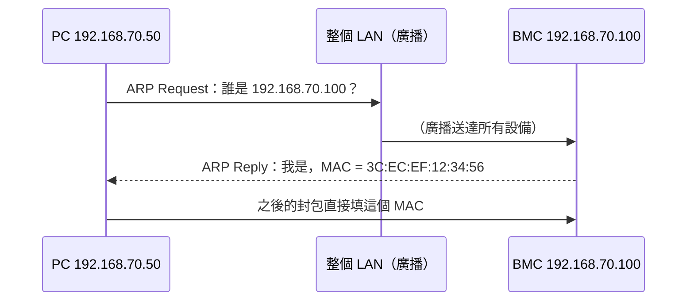
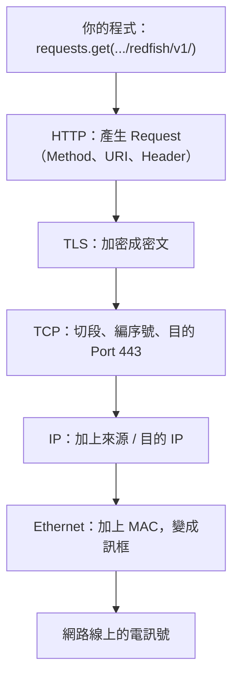
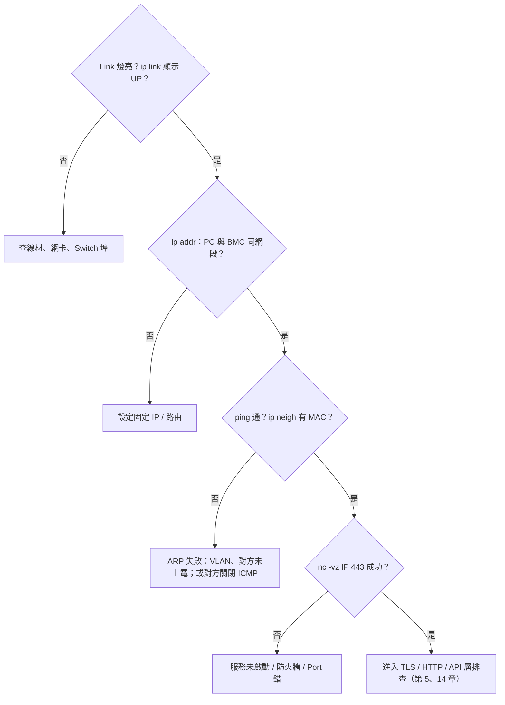

# 網路基本名詞與分層

> 📌 **一句話重點**：**IP 找到「哪一台機器」，Port 找到「機器上的哪個服務」**。網路被切成好幾層，每層只管一件事；Debug 時由下往上一層一層確認。

## 1. Client 與 Server、Request 與 Response

- **Client（用戶端）**：主動發起請求的一方，例如你的 PC 上的 `curl`、Python。
- **Server（伺服端）**：等待並回應請求的一方，例如 BMC 上的 Redfish 服務。
- **Request／Response**：一問一答。

> 💡 注意「Server」有兩個意思：一是硬體（伺服器主機），二是網路角色（提供服務的一方）。BMC 在硬體上是 Server 裡的一顆晶片，在網路上扮演 Redfish **server** 的角色；架 TFTP 時，你的筆電反而是 server。

## 2. 基本名詞

| 名詞 | 白話 | 類比（寄信） | 例子 |
|---|---|---|---|
| **IP Address** | 機器在網路上的邏輯位址 | 大樓地址 | `192.168.70.100` |
| **Subnet Mask** | 標示 IP 中哪一段是「網路」、哪一段是「主機」 | 「同一條街」的範圍 | `255.255.255.0`（即 `/24`） |
| **Gateway** | 通往其他子網路的出口（路由器） | 郵局 | `192.168.70.1` |
| **LAN** | 區域網路，同一個廣播範圍 | 同一社區 | 實驗室 Switch 下的設備 |
| **NIC** | 網路卡 | 大樓的收發室 | `eth0`、`enp3s0` |
| **MAC Address** | 網卡的硬體位址，同一 LAN 內送達用 | 收發室的門牌編號 | `3C:EC:EF:12:34:56` |
| **Port** | 同一台機器上區分不同服務的編號（0–65535） | 大樓裡的房號 | `443`、`623` |

### `192.168.70.100:443` 是什麼意思？

192.168.70.100<small>IP：哪一台機器</small>:443<small>Port：哪個服務（HTTPS）</small>

### 子網路快速判斷

`192.168.70.100/24` 代表前 24 bit（`192.168.70`）是網路位址，同網段範圍是 `192.168.70.1`–`192.168.70.254`。

| 你的 PC | BMC | 同子網路？ | 結果 |
|---|---|---|---|
| `192.168.70.50/24` | `192.168.70.100/24` | ✅ | 直接送達，不需 Gateway |
| `192.168.1.50/24` | `192.168.70.100/24` | ❌ | 需要路由；沒有路由就不通 |
| `192.168.70.50/24` | `192.168.70.100/16` | 遮罩不一致 | 可能單向通，行為怪異，應修正 |

> ✅ 直連 BMC（PC 網路線直接插管理埠）時，最常見的問題就是 **PC 沒有設成同網段的固定 IP**。

### 同一個 LAN 內封包怎麼送到？ARP

IP 是邏輯位址，真正在乙太網路上送達要靠 MAC。**ARP（Address Resolution Protocol）** 負責問「誰是 192.168.70.100？請告訴我你的 MAC」。

用 `ip neigh` 可看 ARP 表；若對方 IP 顯示 `FAILED`／`INCOMPLETE`，代表第二層就不通（線沒接、VLAN 不對、對方沒上電）。

## 3. 為什麼要分層

一次通訊牽涉很多事：電訊號怎麼送、送給誰、怎麼保證送到、內容怎麼解讀。分層讓每層只處理一件事，並且可以**替換**（例如 Wi-Fi 換成有線，上層 HTTP 完全不用改）。

### OSI 七層 vs TCP/IP 模型

<b>7 應用層</b>HTTP、HTTPS、SSH、TFTP、IPMI(RMCP)、DNS；<b>Redfish 是建立在 HTTP 之上的 API 規範</b>

<b>6 表現層</b>資料表示與加密的概念位置：TLS、JSON／UTF-8 編碼常被對應到這裡

<b>5 會談層</b>連線／會談管理的概念位置（實務上併入應用層）

<b>4 傳輸層</b>TCP、UDP — 以 <b>Port</b> 區分服務

<b>3 網路層</b>IP、ICMP（ping）— 以 <b>IP 位址</b> 尋址與路由

<b>2 資料鏈結層</b>Ethernet、ARP、VLAN — 以 <b>MAC 位址</b> 在同一 LAN 送達

<b>1 實體層</b>網路線、光纖、電訊號、Link 燈

| OSI 七層 | TCP/IP 四層 | TCP/IP 五層（教學常用） |
|---|---|---|
| 7 應用、6 表現、5 會談 | 應用層 | 應用層 |
| 4 傳輸 | 傳輸層 | 傳輸層 |
| 3 網路 | 網際網路層 | 網路層 |
| 2 資料鏈結 | 網路存取層 | 資料鏈結層 |
| 1 實體 | 網路存取層 | 實體層 |

> ⚠️ **幾個容易畫錯的地方**
> - **TLS** 位於 TCP 與 HTTP 之間，OSI 沒有一格完全吻合；說「介於傳輸層與應用層之間」最準確。
> - **API、JSON 不是和 TCP、IP 並列的「一層協定」**。JSON 是應用層訊息裡的**資料格式**；API 是應用層上對「可以問什麼、怎麼問」的**約定**。
> - **ARP** 介於第 2、3 層之間；**ICMP** 屬於第 3 層，沒有 Port 的概念。

## 4. 封裝：一個 Redfish 請求的洋蔥結構

每往下一層，就在外面多包一層「信封」（Header）：

Ethernet<small>MAC</small>IP<small>來源／目的 IP</small>TCP<small>來源／目的 Port</small>TLS<small>加密</small>HTTP<small>GET /redfish/v1/</small>JSON<small>資料本體</small>

對方（BMC）收到後由下往上一層層拆開。

## 5. 各協定在哪一層（速記表）

| 協定／名詞 | 層級 | 一句話 |
|---|---|---|
| Ethernet | 2 | 同一 LAN 內以 MAC 傳送訊框 |
| ARP | 2–3 之間 | 由 IP 查 MAC |
| IP | 3 | 尋址與路由 |
| ICMP | 3 | 診斷與錯誤回報（`ping`） |
| TCP | 4 | 可靠、有序的位元組串流 |
| UDP | 4 | 無連線的資料報 |
| TLS | 4 與 7 之間 | 加密、完整性、身分驗證 |
| HTTP／HTTPS | 7 | 請求／回應 |
| SSH／SFTP | 7（TCP 22） | 安全遠端 Shell／檔案傳輸 |
| TFTP | 7（UDP 69） | 簡易檔案傳輸 |
| IPMI over LAN (RMCP) | 7（UDP 623） | 平台管理命令 |
| Redfish | 7（HTTPS 之上的 API 規範） | 資源導向的管理 API |
| JSON | 應用層的**資料格式** | 不是協定 |

## 6. 常見誤解

| 誤解 | 正確觀念 |
|---|---|
| IP 和 MAC 擇一就好 | IP 負責跨網路尋址；MAC 負責同一 LAN 的最後一哩 |
| Port 是實體的洞 | 「網路埠」(Port number) 是軟體編號；RJ45 插孔也叫 port，但意思不同 |
| ping 得到就代表服務正常 | ping 只驗證第 3 層；服務在第 4–7 層 |
| JSON 是一種協定 | JSON 是資料格式，由 HTTP 等協定承載 |

## 7. Debug 流程：由下往上

## 8. 練習題

**Q1.** IP Address 與 Port 有何不同？

看解答

IP（第 3 層）識別網路上的哪一台主機並用於路由；Port（第 4 層）識別該主機上的哪一個服務／程序。`IP:Port` 才能唯一指向一個網路服務端點。

**Q2.** PC 是 `192.168.1.10/24`，BMC 是 `192.168.70.100/24`，直接用網路線對接，ping 不通。原因與解法？

看解答

兩者不同子網路，PC 會把封包送往預設閘道而非直接送給 BMC。解法：把 PC 該網卡設為 `192.168.70.x/24`（不與他人衝突）的固定 IP。

**Q3.** TLS 在分層模型中位於哪裡？

看解答

位於 TCP（傳輸層）之上、HTTP（應用層）之下；OSI 中常對應到表現層／會談層，但不完全吻合。

**Q4.** 為什麼說「JSON 不是一層協定」？

看解答

JSON 只規定資料如何用文字表示（物件、陣列、字串…），不規定如何傳送、如何建立連線。它是被 HTTP 等應用層協定承載的內容格式。

**Q5.** `ip neigh` 中 BMC 的 IP 顯示 `INCOMPLETE` 代表什麼？

看解答

ARP 請求送出但沒收到回應，即第 2 層不通：可能線路／VLAN 問題、BMC 未上電或不在該 IP。

**🔧 動手練習**（🟢 唯讀，可直接執行）：在 Linux 執行 `ip addr`、`ip route`、`ip neigh`，寫下你的 IP、遮罩、預設閘道，並判斷 `<BMC_IP>` 是否與你同子網路。

---

## 🧩 整合題（第 1–3 章）

你把筆電直接接到一台伺服器的管理埠，想用瀏覽器開 `https://192.168.70.100/redfish/v1/`，請列出這個請求成功前，從實體層到應用層各需要滿足什麼條件，並指出其中哪一步與「伺服器主機 OS 是否開機」無關。

看解答

1. 實體層：網路線接在**管理埠**，Link 燈亮。
2. 資料鏈結層：ARP 能解析到 BMC 的 MAC。
3. 網路層：筆電設為 `192.168.70.x/24`，與 BMC 同子網路。
4. 傳輸層：BMC 的 TCP 443 有服務在聽，三向交握成功。
5. TLS：完成握手（自簽憑證時瀏覽器會警告）。
6. 應用層：HTTP GET 得到 200 與 JSON。

**全部步驟都與主機 OS 是否開機無關**——只要 AC 插著、BMC 由待機電源供電並完成開機即可（第 1 章）。

