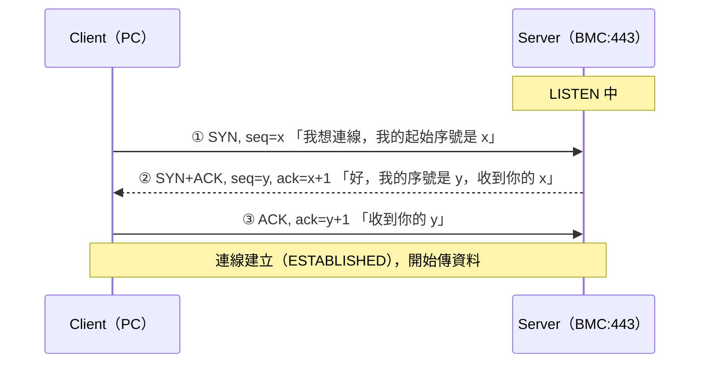
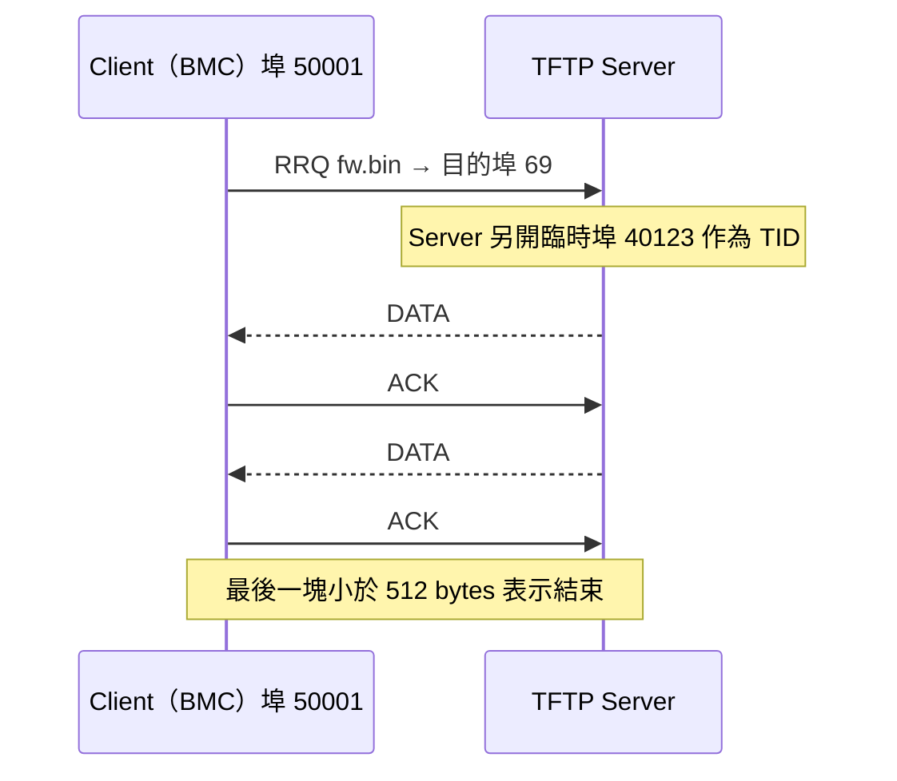
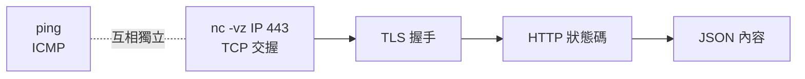

# TCP、UDP 與 Port

> 📌 **一句話重點**：**TCP 像打電話**（先接通、確認對方有聽到、照順序講）；**UDP 像寄明信片**（寫了就寄，不保證到、不保證順序）。Redfish 用 TCP 443；IPMI 與 TFTP 用 UDP。

## 1. TCP（Transmission Control Protocol）

TCP 提供**連線導向、可靠、有序的位元組串流（byte stream）**。

| 機制 | 做什麼 |
|---|---|
| 三向交握 | 傳資料前先建立連線，雙方同步初始序號 |
| 序號（Sequence Number） | 為每個 byte 編號，接收端可重排、去重 |
| 確認（ACK） | 告訴對方「我收到哪裡了」 |
| 重傳 | 逾時或收到重複 ACK 就重送 |
| 流量控制（Flow Control） | 接收端用 Window 告知還能收多少，避免被灌爆 |
| 壅塞控制（Congestion Control） | 偵測網路壅塞時主動降速 |

> ⚠️ TCP 是「**串流**」不是「訊息」：你 `send` 兩次，對方可能一次 `recv` 收到合併的資料。訊息邊界由上層協定（如 HTTP 的 `Content-Length`）決定。

### 1.1 三向交握（Three-way Handshake）

| 步驟 | 目的 |
|---|---|
| ① SYN | Client 表明要連線，並送出自己的初始序號 |
| ② SYN-ACK | Server 同意，確認收到 Client 序號，並送出自己的初始序號 |
| ③ ACK | Client 確認收到 Server 序號；**雙方都確認對方「能收也能送」** |

為什麼不是兩次？因為 Server 需要知道「我的 SYN-ACK 對方真的收到了」，否則無法確定雙向都通。

### 1.2 連線關閉

正常關閉為四次揮手（雙方各送 FIN、各回 ACK）；異常時會出現 **RST**（Reset）立刻中斷。

### 1.3 交握失敗時看到什麼

| 現象 | 封包層面 | 常見原因 |
|---|---|---|
| `Connection refused` | 送 SYN，立刻收到 **RST** | 主機在，但該 Port **沒有服務在聽** |
| `Connection timed out` | 送 SYN，**完全沒回應** | 防火牆丟棄、IP 不存在、路由不通 |
| `No route to host` | 本機就送不出去或收到 ICMP unreachable | 不同網段且無路由、ARP 失敗 |

## 2. UDP（User Datagram Protocol）

UDP 是**無連線**的**資料報（datagram）**傳輸：每個封包獨立，沒有交握、沒有內建重傳與排序。

- 保留**訊息邊界**：送一個 datagram，對方就收一個 datagram（或沒收到）。
- Header 只有 8 bytes（來源 Port、目的 Port、長度、Checksum）。
- 可靠性若有需要，由**應用層自己做**（TFTP 的 ACK、IPMI 的序號與重試）。

> ⚠️ **UDP 不等於「一定比較快」**。它只是少了交握與等待重傳的延遲；吞吐量與可靠度取決於上層怎麼做。TFTP 走 UDP 但一來一回逐塊確認，其實很慢。

## 3. TCP vs UDP

| | TCP | UDP |
|---|---|---|
| 連線 | 需要先交握 | 不需要 |
| 可靠性 | 保證送達、有序、不重複 | 不保證 |
| 資料型態 | 位元組串流 | 獨立資料報 |
| Header | 至少 20 bytes | 8 bytes |
| 「Port 通不通」好不好測 | 好測（交握成功即通） | 難測（沒回應≠不通） |
| 本主題的例子 | HTTPS／Redfish（443）、SSH（22） | IPMI RMCP（623）、TFTP（69） |

## 4. Port

Port 是 16-bit 數字（0–65535），讓同一個 IP 上可以同時跑很多服務。

| Port | 傳輸 | 服務 | 本主題用途 |
|---|---|---|---|
| 22 | TCP | SSH／SFTP | 登入 BMC Shell、傳檔 |
| 80 | TCP | HTTP | 未加密網頁（常被導向 443） |
| 443 | TCP | HTTPS | **Redfish**、BMC Web UI |
| 69 | UDP | TFTP（初始請求） | 韌體檔案傳輸 |
| 623 | UDP | IPMI over LAN（RMCP／RMCP+） | `ipmitool -I lanplus` |

- **Server 端**用固定的「知名埠」等待連線。
- **Client 端**由 OS 隨機挑一個「臨時埠」（ephemeral port，例如 49152–65535 範圍）。
- 一條 TCP 連線由**四元組**唯一識別：`來源 IP、來源 Port、目的 IP、目的 Port`。

192.168.70.50 : 51234<small>Client（臨時埠）</small>→192.168.70.100 : 443<small>Server（知名埠）</small>

## 5. TFTP 與 TID：不是全程都在 UDP 69

TFTP（[第 15 章](#/doc/ch15) 詳述）只有**第一個請求封包**送到 UDP 69。Server 回覆時會改用一個新的臨時埠，這個埠號稱為 **TID（Transfer Identifier）**，之後雙方就用這一對埠通訊。

> ⚠️ **實務影響**：防火牆只開 UDP 69 是不夠的——回程資料來自另一個埠，可能被擋。這是 TFTP「請求送得出去但檔案傳不回來」的常見原因。

## 6. 兩個重要的「不代表」

1. **TCP 連線成功 ≠ API 授權成功**：`nc -vz <BMC_IP> 443` 成功只代表第 4 層通；帳密錯仍會得到 HTTP 401。
2. **ping 不通 ≠ HTTPS 不通**：ping 用 ICMP（第 3 層），可能被防火牆或 BMC 設定關閉，但 TCP 443 仍可用。反之 ping 通也不代表 443 有開。

## 7. 常見誤解

| 誤解 | 正確觀念 |
|---|---|
| UDP 一定比 TCP 快 | 只是開銷較小；實際速度看應用層設計 |
| TCP 保證「訊息」完整送達 | 保證的是 byte 串流有序可靠，訊息邊界靠上層 |
| 用 `nc -vz` 測 UDP 623 成功就代表 IPMI 通 | UDP 沒有交握，`nc -u` 的「成功」通常只代表沒收到 ICMP 錯誤；要用 `ipmitool` 實際發命令驗證 |
| TFTP 只需要開 UDP 69 | 資料傳輸使用另一個臨時埠（TID） |

## 8. 練習題

**Q1.** TCP 與 UDP 的根本差別？

看解答

TCP 連線導向，提供可靠、有序、具流量與壅塞控制的位元組串流；UDP 無連線，提供盡力而為的獨立資料報，不保證送達與順序，可靠性交由應用層處理。

**Q2.** 三向交握的三個封包分別是什麼？各自確認了什麼？

看解答

SYN（Client 要求連線並送初始序號）→ SYN-ACK（Server 同意、確認 Client 序號並送自己的序號）→ ACK（Client 確認 Server 序號）。完成後雙方都確認對方收發能力與初始序號。

**Q3.** `Connection refused` 與 `Connection timed out` 的差別？

看解答

refused：對方主機有回應 RST，表示主機可達但該埠無服務。timed out：SYN 沒有任何回應，多為防火牆丟包、IP 不存在或路由不通。

**Q4.** 為什麼 TFTP 防火牆只開 UDP 69 可能失敗？

看解答

Server 以新的臨時埠（TID）回覆 DATA／ACK，後續流量不在 69；若防火牆沒有對應的連線追蹤 helper 或開放範圍，回程封包會被擋。

**Q5.** `nc -vz <BMC_IP> 443` 成功，但 `curl` 得到 401，哪一層有問題？

看解答

傳輸層（TCP）與 TLS 都正常；問題在應用層的**認證**（帳號密碼／Token 錯誤或缺少）。

**🔧 動手練習**（🟢 唯讀）：對一個你有權限的 HTTPS 服務執行 `nc -vz <HOST> 443` 與 `nc -vz <HOST> 81`，觀察成功、refused、timeout 三種輸出的差別並記錄。
