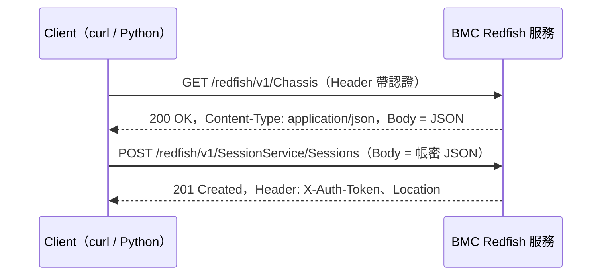
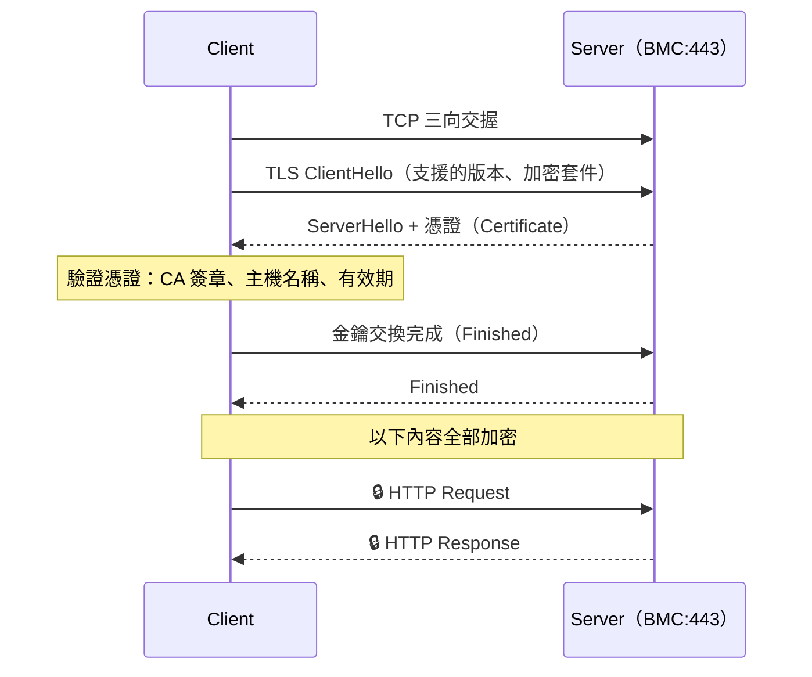
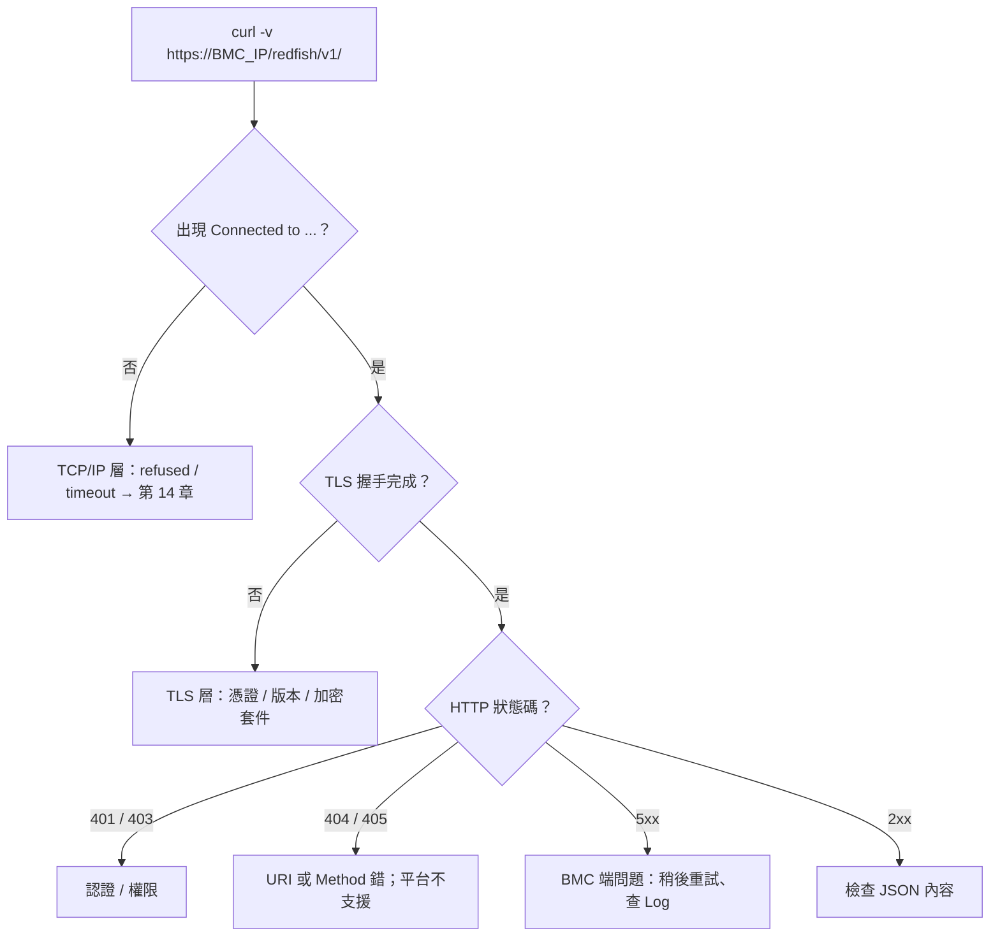

# HTTP、HTTPS 與 TLS

> 📌 **一句話重點**：HTTP 是「一問一答」的文字協定；HTTPS 就是把同樣的 HTTP 訊息放進 **TLS 加密通道**裡傳（通常是 TCP 443）。Redfish 的一切操作都是 HTTP 的 Method ＋ URI ＋ JSON。

## 1. HTTP Request 的結構

```http
GET /redfish/v1/UpdateService/FirmwareInventory HTTP/1.1
Host: 192.168.70.100
Accept: application/json
X-Auth-Token: <TOKEN>

```

<div class="frame"><span class="c">Request Line<small>Method ＋ URI ＋ 版本</small></span><span class="a">Headers<small>Host、Accept、認證…</small></span><span class="p">空行</span><span class="d">Body<small>GET 通常沒有；POST／PATCH 放 JSON</small></span></div>

## 2. HTTP Response 的結構

```http
HTTP/1.1 200 OK
Content-Type: application/json; charset=utf-8
Content-Length: 512
ETag: "a1b2c3"

{"@odata.id": "/redfish/v1/UpdateService/FirmwareInventory", "Members": [ ... ]}
```

<div class="frame"><span class="k">Status Line<small>版本 ＋ 狀態碼 ＋ 原因</small></span><span class="a">Headers<small>Content-Type、Location…</small></span><span class="p">空行</span><span class="d">Body<small>JSON 資料</small></span></div>



## 3. HTTP Method

| Method | 意義 | 會改變狀態？ | Redfish 例子 |
|---|---|---|---|
| **GET** | 讀取資源 | 否（安全、可重複） | 讀 FirmwareInventory、讀 PSU 資料 |
| **POST** | 建立資源／執行動作 | 是 | 建立 Session；執行 `ComputerSystem.Reset` Action |
| **PATCH** | 修改資源的部分欄位 | 是 | 修改 BMC 網路設定、風扇策略 |
| **DELETE** | 刪除資源 | 是 | 刪除 Session（登出） |
| PUT | 整個取代資源 | 是 | Redfish 較少用 |
| HEAD | 只要 Header | 否 | 檢查資源是否存在 |

> 🔴 **風險分級**：GET 是唯讀，可以放心練習。POST／PATCH／DELETE 會改變設備狀態（重啟、改設定、更新韌體），**必須先確認設備是授權的測試機、了解後果**再執行。

## 4. HTTP Status Code

| 範圍 | 意義 |
|---|---|
| 2xx | 成功 |
| 3xx | 重新導向 |
| 4xx | **Client 這邊的問題**（請求有錯、沒權限、找不到） |
| 5xx | **Server 那邊的問題**（BMC 內部錯誤、忙碌） |

| 碼 | 名稱 | 在 Redfish 遇到時代表什麼 |
|---|---|---|
| 200 | OK | 成功，Body 有資料 |
| 201 | Created | 建立成功（例：Session 建立），看 `Location` Header |
| 202 | Accepted | 已接受、背景執行中（例：韌體更新），看回傳的 Task |
| 204 | No Content | 成功但沒有 Body（例：DELETE Session、某些 Action） |
| 400 | Bad Request | JSON 格式錯、欄位名稱／型別錯、參數值不合法 |
| 401 | Unauthorized | **沒認證或認證失敗**：帳密錯、Token 過期、沒帶認證 |
| 403 | Forbidden | **已認證但權限不足**：帳號角色不允許此操作 |
| 404 | Not Found | URI 不存在：路徑打錯、該平台沒有此資源 |
| 405 | Method Not Allowed | 該資源不支援此 Method（例：對唯讀資源 PATCH），看 `Allow` Header |
| 409 | Conflict | 與目前狀態衝突（例：正在更新中又要求更新） |
| 500 | Internal Server Error | BMC 內部錯誤；可稍後重試、查 BMC Log |
| 503 | Service Unavailable | 服務暫時無法使用（BMC 剛開機、忙碌），看 `Retry-After` |

> 💡 **401 vs 403 記法**：401＝「你是誰？」（身分沒確認）；403＝「我知道你是誰，但你不能做這件事」。

## 5. HTTPS ＝ HTTP ＋ TLS


<p class="figcap">圖 5-1　HTTPS 連線建立順序（TLS 握手細節已簡化）</p>

**TLS（Transport Layer Security）** 提供三件事：

| 保護 | 意義 | 沒有它會怎樣 |
|---|---|---|
| **加密（Confidentiality）** | 第三者看不到內容 | 帳密、Token 明文外洩 |
| **完整性（Integrity）** | 內容被竄改會被發現 | 回應被中途修改 |
| **伺服器身分驗證（Authentication）** | 確認對方真的是你要連的主機 | 被中間人（MITM）冒充 |

> 📌 HTTPS 通常是 TCP 443。進階補充：HTTP/3 改用建立在 **UDP** 上的 QUIC，但 BMC 的 Redfish 目前仍以 TCP 上的 HTTP/1.1 為主。

### 5.1 憑證、CA、自簽憑證

- **憑證（Certificate）**：伺服器的「身分證」，包含公鑰、主機名稱（或 IP）、有效期，並由發行者簽章。
- **CA（Certificate Authority）**：受信任的發證機構。Client 內建一份信任的 CA 清單。
- **自簽憑證（Self-signed）**：自己簽自己。BMC 出廠預設幾乎都是自簽憑證，Client 無法驗證 → 出現憑證錯誤。

### 5.2 `curl -k` 到底略過了什麼？

`-k`（`--insecure`）讓 curl **跳過伺服器憑證驗證**：不檢查簽發者是否受信任、不檢查主機名稱是否相符、不檢查是否過期。

| | 加密 | 完整性 | 身分驗證 |
|---|---|---|---|
| 正常 HTTPS | ✅ | ✅ | ✅ |
| `curl -k`／`verify=False` | ✅ 仍然加密 | ✅ | ❌ **不知道對方是誰** |

> 🔴 `curl -k` 與 `requests(..., verify=False)` **只可用於隔離的實驗環境**。因為不驗證身分，中間人可以冒充 BMC 收走你的帳密。正式環境應：把 BMC 憑證換成公司 CA 簽發的憑證，或把 BMC 的自簽憑證／CA 匯出後用 `--cacert` 指定。

## 6. curl 常用選項

| 選項 | 意義 | 注意事項 |
|---|---|---|
| `-v` | 顯示詳細過程（TCP、TLS、Request／Response Header） | **Debug 第一選擇**；輸出可能含認證 Header，貼給別人前要遮蔽 |
| `-i` | 輸出包含 Response Header | 看狀態碼、`Location`、`X-Auth-Token` |
| `-s` | 安靜模式（不顯示進度） | 搭配 `jq` |
| `-k` | 跳過憑證驗證 | 只限實驗 |
| `--cacert <檔>` | 指定信任的 CA 憑證 | 正式做法 |
| `-u '<USER>'` | HTTP Basic Auth；不寫密碼會互動詢問 | **不要寫成 `-u user:password`**：會留在 shell history 與行程列表（`ps`） |
| `-H 'Name: value'` | 加 Header | 例：`-H 'X-Auth-Token: ...'`、`-H 'Content-Type: application/json'` |
| `-X <METHOD>` | 指定 Method | GET 不必寫；POST／PATCH／DELETE 要小心 |
| `-d '<資料>'` | 送出 Body（預設變成 POST） | JSON 要搭配 Content-Type |
| `--max-time <秒>` | 總逾時 | 自動化必加 |
| `-w '%{http_code}\n'` | 印出狀態碼 | 腳本判斷用 |

**🟢 可執行（需填參數、唯讀）**

```bash
# 逐段拆解：
#   --cacert  用指定 CA 驗證 BMC 憑證
#   -u        只給帳號，密碼互動輸入（不進 history）
#   -s        不顯示進度條
#   -i        連同 Response Header 一起印出
curl --cacert <CA_CERT_PATH> -u '<USER>' -s -i \
  'https://<BMC_IP>/redfish/v1/'
```

成功輸出（節錄）：

```text
HTTP/1.1 200 OK
Content-Type: application/json
...
{"@odata.id":"/redfish/v1/","RedfishVersion":"1.x.x","Systems":{"@odata.id":"/redfish/v1/Systems"}, ...}
```

憑證驗證失敗時：

```text
curl: (60) SSL certificate problem: self-signed certificate
```

## 7. 錯誤發生在哪一層？

| curl 訊息 | 層級 | 意義 |
|---|---|---|
| `Could not resolve host` | DNS | 主機名稱解析失敗 |
| `(7) Failed to connect ... Connection refused` | TCP | 443 沒有服務在聽 |
| `(28) Connection timed out` | IP／TCP | 封包沒回應 |
| `(35) SSL connect error`／`(60) SSL certificate problem` | **TLS** | 握手或憑證驗證失敗 |
| `HTTP/1.1 401`／`403`／`404`／`500` | **HTTP（應用層）** | TCP 與 TLS 都已成功，問題在請求本身或服務端 |
| `200` 但內容不如預期 | API／資料層 | 欄位不存在、空集合、平台不支援 |

> ✅ **關鍵判斷**：只要你**看得到 HTTP 狀態碼**，就代表網路、TCP、TLS 都是通的，請把注意力放在應用層。



## 8. 常見誤解

| 誤解 | 正確觀念 |
|---|---|
| `curl -k` 就是沒加密 | 仍然加密，只是不驗證對方身分 |
| HTTPS 是另一種協定 | 是同樣的 HTTP 訊息包在 TLS 裡 |
| 404 代表網路不通 | 能收到 404 代表網路完全通，只是路徑不存在 |
| 401 和 403 一樣 | 401 是認證問題，403 是授權（權限）問題 |

## 9. 練習題

**Q1.** HTTP Request 由哪些部分組成？

<details><summary>看解答</summary>

Request Line（Method、URI、HTTP 版本）、Headers、空行、可選的 Body。

</details>

**Q2.** GET、POST、PATCH、DELETE 各舉一個 Redfish 例子。

<details><summary>看解答</summary>

GET 讀 FirmwareInventory；POST 建立 Session 或執行 Reset Action；PATCH 修改 Manager 網路設定；DELETE 刪除 Session。

</details>

**Q3.** TLS 保護哪三件事？`curl -k` 放棄了哪一件？

<details><summary>看解答</summary>

加密、完整性、伺服器身分驗證。`-k` 放棄身分驗證，因此無法防止中間人攻擊。

</details>

**Q4.** 收到 `405 Method Not Allowed` 應該怎麼查？

<details><summary>看解答</summary>

該 URI 存在但不支援這個 Method。查看回應的 `Allow` Header 得知支援哪些 Method，並確認是否對唯讀資源做了 PATCH／POST，或 Action 的 URI 是否正確。

</details>

**Q5.** 為什麼不建議 `curl -u user:password`？

<details><summary>看解答</summary>

密碼會出現在 shell history、行程參數列表（其他使用者可用 `ps` 看到）以及 CI Log 中。應只給帳號讓 curl 互動詢問，或使用環境變數／受權限保護的設定檔（如 `--netrc-file`）。

</details>

**🔧 動手練習**（🟢 唯讀）：對任一公開 HTTPS 網站執行 `curl -v https://example.com/ -o /dev/null`，在輸出中標出 ① TCP 連線 ② TLS 握手與憑證資訊 ③ Request Header ④ Response 狀態碼。
