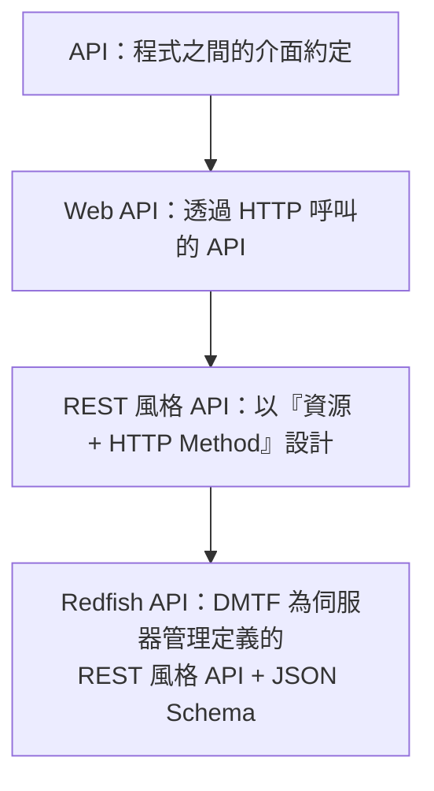
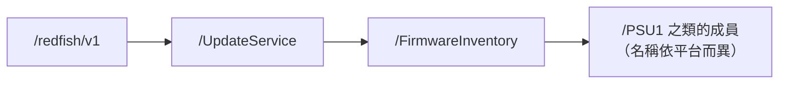

# API、REST API 與 URI

> 📌 **一句話重點**：API 是「程式跟程式之間的約定」。Redfish API ⊂ REST 風格的 Web API ⊂ API。你早就在用 API 了——PyVISA 的 `inst.query()` 就是。

## 1. API 不只限於網路

**API（Application Programming Interface，應用程式介面）**：一方提供功能，並約定「怎麼呼叫、給什麼參數、回傳什麼」。

| 類型 | 例子 | 呼叫方式 |
|---|---|---|
| 函式庫 API | Python `json.loads()`、`requests.get()` | 函式呼叫 |
| 儀器控制 API | PyVISA：`inst.write()`、`inst.query()` | 函式呼叫 → 透過 GPIB／USB／LAN 送出 |
| 作業系統 API | Linux `open()`、`ioctl()`（i2c-dev） | 系統呼叫 |
| **Web API** | Redfish、GitHub API | HTTP 請求 |

### 用熟悉的 PyVISA／SCPI 來類比

| | 儀器世界 | Server 管理世界 |
|---|---|---|
| 你寫的程式 | Python | Python |
| 程式庫 API | **PyVISA**（`inst.query("*IDN?")`） | **requests**（`requests.get(url)`） |
| 傳輸 | GPIB／USB／LAN (VXI-11, HiSLIP) | TCP／TLS／HTTP |
| 「命令語言」 | **SCPI**（`MEAS:VOLT?`） | **Redfish**（`GET /redfish/v1/Chassis/1/Power`） |
| 回傳格式 | 文字（`+1.2003E+01`） | JSON |
| 對象 | 電源供應器、示波器 | BMC |

> 💡 PyVISA 是「怎麼把字串送到儀器」的 API；SCPI 是「送什麼字串」的命令標準。同理，requests／HTTP 是「怎麼送」，Redfish 是「送什麼、資源長什麼樣」。

## 2. Web API、REST API、Redfish API 的關係



**REST（Representational State Transfer）** 是一種**架構風格**（不是協定、不是標準文件），主要想法：

1. 每個東西都是**資源（Resource）**，有唯一的 **URI**。
2. 用標準 **HTTP Method** 操作資源（GET 讀、POST 建、PATCH 改、DELETE 刪）。
3. Server 回傳資源的**表示（Representation）**，通常是 JSON。
4. **無狀態（Stateless）**：每個請求自帶所需資訊（例如認證 Token）。
5. 資源之間用**連結**串起來（Redfish 的 `@odata.id`）。

## 3. 名詞對照

| 名詞 | 意義 | 例子 |
|---|---|---|
| Resource | 被管理的東西 | 一顆 PSU、一份韌體清單 |
| URI | 資源的位址 | `/redfish/v1/Chassis/1/PowerSubsystem/PowerSupplies/1` |
| Endpoint | API 對外的一個存取點（常與 URI 混用） | `https://<BMC_IP>/redfish/v1/` |
| Method | 對資源做什麼 | GET |
| Payload／Body | 請求或回應攜帶的資料 | `{"ResetType": "ForceRestart"}` |
| **Authentication（認證）** | 確認「你是誰」 | 帳號密碼、Session Token → 失敗得 **401** |
| **Authorization（授權）** | 確認「你能做什麼」 | 角色：Administrator／Operator／ReadOnly → 失敗得 **403** |

## 4. URL 逐段拆解

```text
https://192.168.70.100:443/redfish/v1/UpdateService/FirmwareInventory?$top=5
```

<div class="frame"><span class="rw">https<small>scheme 協定</small></span><span class="a">192.168.70.100<small>host 主機</small></span><span class="k">:443<small>port（可省略）</small></span><span class="c">/redfish/v1/UpdateService/FirmwareInventory<small>path 資源路徑</small></span><span class="d">?$top=5<small>query 查詢參數（選用）</small></span></div>

| 部分 | 說明 |
|---|---|
| **scheme** | `https`：使用 HTTP over TLS；決定預設埠 443（`http` 為 80） |
| **host** | IP 或主機名稱；決定連到哪台機器 |
| **port** | 省略時用 scheme 的預設值 |
| **path** | 資源在該服務內的階層位置；Redfish 一律以 `/redfish/v1/` 開頭 |
| **query** | 額外參數；Redfish 定義了 `$expand`、`$top`、`$skip`、`$select` 等，但**是否支援依實作而定** |

> 📌 **URI vs URL**：URL 是「帶有存取方式的 URI」。日常溝通可互換；Redfish 文件多用 URI。

path 的階層反映資源的包含關係：



## 5. RESTful 操作與 Actions

大多數操作都能用「Method ＋ 資源」表達：

| 想做的事 | 請求 |
|---|---|
| 看有哪些 Chassis | `GET /redfish/v1/Chassis` |
| 看 PSU 1 | `GET .../PowerSupplies/1` |
| 登入 | `POST /redfish/v1/SessionService/Sessions` |
| 登出 | `DELETE /redfish/v1/SessionService/Sessions/<id>` |
| 改 BMC 主機名稱 | `PATCH /redfish/v1/Managers/<id>/EthernetInterfaces/<id>` |

但「重開機」不是修改某個欄位，而是一個**動作**。Redfish 用 **Action** 表達，一律以 **POST** 呼叫，URI 形如 `.../Actions/<資源型別>.<動作名>`：

**⚪ 純示意（🔴 會重啟主機，不要在非授權設備執行）**

```http
POST /redfish/v1/Systems/<SYSTEM_ID>/Actions/ComputerSystem.Reset
Content-Type: application/json

{"ResetType": "GracefulRestart"}
```

資源本身會告訴你它支援哪些 Action 與參數值：

```json
"Actions": {
  "#ComputerSystem.Reset": {
    "target": "/redfish/v1/Systems/1/Actions/ComputerSystem.Reset",
    "ResetType@Redfish.AllowableValues": ["On", "ForceOff", "GracefulShutdown", "GracefulRestart", "ForceRestart"]
  }
}
```

> ✅ **好習慣**：不要自己拼 Action 的 URI，從資源的 `Actions` → `target` 讀出來用；允許的參數值看 `@Redfish.AllowableValues`。

常見 Action：`ComputerSystem.Reset`（主機電源）、`Manager.Reset`（重啟 BMC）、`UpdateService.SimpleUpdate`（韌體更新）、`LogService.ClearLog`（清 Log）。

## 6. 常見誤解

| 誤解 | 正確觀念 |
|---|---|
| API 一定是網路上的東西 | 函式庫、OS、儀器驅動都有 API |
| REST 是一種協定 | REST 是設計風格；協定是 HTTP |
| Redfish 是 REST 的同義詞 | Redfish 是採用 REST 風格、針對硬體管理的**具體規範** |
| 知道一台機器的 URI 就能套用到所有機器 | 成員 ID、路徑深度依廠商／機型不同，要跟著連結走 |
| 認證通過就什麼都能做 | 還要看授權（角色權限） |

## 7. 練習題

**Q1.** 說明 API、Web API、REST API、Redfish API 的包含關係。

<details><summary>看解答</summary>

API 最廣，泛指程式介面；Web API 是透過 HTTP 提供的 API；REST API 是遵循 REST 風格（資源＋HTTP Method＋無狀態）的 Web API；Redfish 是 DMTF 以 REST 風格為伺服器管理定義的具體 API 規範與 Schema。

</details>

**Q2.** 把 `https://10.0.0.5/redfish/v1/Chassis/1` 拆成 scheme、host、port、path。

<details><summary>看解答</summary>

scheme=`https`；host=`10.0.0.5`；port 省略→預設 `443`；path=`/redfish/v1/Chassis/1`。

</details>

**Q3.** PyVISA 與 SCPI 的關係，類比到 Redfish 世界分別是什麼？

<details><summary>看解答</summary>

PyVISA（傳送管道的程式庫 API）≈ requests／HTTP；SCPI（命令語言標準）≈ Redfish（資源與操作的標準）。

</details>

**Q4.** 為什麼重開機要用 Action 而不是 PATCH？

<details><summary>看解答</summary>

重開機是一個「動作／程序」，不是把某個屬性改成某個值。Redfish 以 POST 到 `Actions/...` 的 target 表達這類操作，並可帶參數（ResetType）。

</details>

**Q5.** Authentication 與 Authorization 的差別，各對應哪個 HTTP 狀態碼？

<details><summary>看解答</summary>

Authentication 驗證身分（失敗→401）；Authorization 判斷權限（失敗→403）。

</details>

**🔧 動手練習**：拿你寫過的一段 PyVISA 程式，畫一張對照圖：哪一行是「程式庫 API」、哪個字串是「命令標準」、底下走什麼傳輸；然後在旁邊畫出 Redfish 版本的對應。

---

## 🧩 整合題（第 4–6 章）

你執行 `curl -k -u admin https://192.168.70.100/redfish/v1/Chassis/1/Power`，得到 `HTTP/1.1 404 Not Found`。請說明：(a) 哪些層已確定正常；(b) 404 可能的原因；(c) 下一步怎麼做。

<details><summary>看解答</summary>

(a) IP 可達、TCP 443 交握成功、TLS 握手成功（`-k` 跳過憑證驗證）、HTTP 請求有被服務處理。只要看到狀態碼，下層都通。

(b) 路徑不存在：Chassis 的 ID 可能不是 `1`；或該平台使用新版 `PowerSubsystem` 而沒有 `Power`；或連到的是不管理 PSU 的控制器。（若是帳密錯會是 401，不是 404。）

(c) 從 `GET /redfish/v1/Chassis` 讀 `Members`，跟著 `@odata.id` 進入實際的 Chassis，再看它有哪些連結（`Power`／`PowerSubsystem`／`Sensors`），不要猜路徑。

</details>
