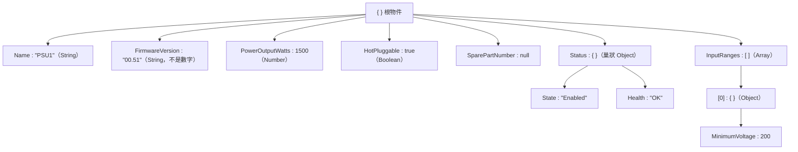
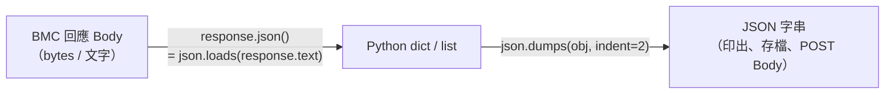
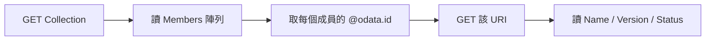

# JSON 全面理解

> 📌 **一句話重點**：JSON 是一種用純文字表示結構化資料的格式，只有 **6 種型別**。到了 Python 就是 `dict` 和 `list` 的巢狀組合——會用 `data["A"]["B"][0]` 取值就會讀 Redfish。

## 1. 怎麼唸、從哪來

- **JSON = JavaScript Object Notation**。
- 唸法：**「Jason」（傑森，/ˈdʒeɪsən/）**，一般不逐字母唸 J-S-O-N。
- 語法源自 JavaScript 的物件寫法，但**與語言無關**：Python、C、Go、Shell（`jq`）都能讀寫。標準為 RFC 8259。

## 2. 六種型別

| JSON 型別 | 寫法 | 例子 | Python 對應 |
|---|---|---|---|
| **Object 物件** | `{ "key": value, ... }` | `{"Health": "OK"}` | `dict` |
| **Array 陣列** | `[ value, ... ]` | `[1, 2, 3]` | `list` |
| **String 字串** | 一定用**雙引號** | `"PSU1"` | `str` |
| **Number 數字** | 整數或小數，不加引號 | `1500`、`12.05` | `int`／`float` |
| **Boolean 布林** | 小寫 | `true`、`false` | `True`、`False` |
| **null 空值** | 小寫 | `null` | `None` |

語法規則（最常踩的雷）：

- key **必須是雙引號字串**；不能用單引號。
- 最後一個元素後面**不能有逗號**。
- **沒有註解**語法。
- `"1500"`（字串）和 `1500`（數字）是不同型別。

## 3. 讀懂一份巢狀 JSON

```json
{
  "Name": "PSU1",
  "FirmwareVersion": "00.51",
  "PowerOutputWatts": 1500,
  "HotPluggable": true,
  "SparePartNumber": null,
  "Status": {
    "State": "Enabled",
    "Health": "OK"
  },
  "InputRanges": [
    { "InputType": "AC", "MinimumVoltage": 200, "MaximumVoltage": 240 }
  ]
}
```

> ⚠️ 以上是**教學自訂的模擬資料**，不保證符合任何 Redfish PowerSupply Schema 的實際回應。



取值（Python）：

```python
firmware = data["FirmwareVersion"]                # "00.51"
health   = data["Status"]["Health"]               # "OK"
vmin     = data["InputRanges"][0]["MinimumVoltage"]  # 200
```

> 💡 **讀法口訣**：看到 `{` 用 **key** 取；看到 `[` 用 **索引或迴圈** 取。

## 4. Python 的三個函式，別搞混

| 函式 | 輸入 → 輸出 | 用途 |
|---|---|---|
| `json.loads(s)` | JSON **字串** → Python 物件 | 解析（load **s**tring） |
| `json.dumps(obj)` | Python 物件 → JSON **字串** | 序列化（dump **s**tring）；`indent=2` 美化、`ensure_ascii=False` 保留中文 |
| `json.load(f)`／`json.dump(obj, f)` | 檔案 ↔ Python 物件 | 讀寫檔案 |
| `response.json()` | HTTP 回應 Body → Python 物件 | `requests` 提供，等同對 `response.text` 做 `json.loads` |



**🟢 可直接執行（純 Python，不需設備）**

```python
import json

text = '{"Name": "PSU1", "PowerOutputWatts": 1500, "Status": {"Health": "OK"}, "Spare": null}'
data = json.loads(text)

print(type(data))                    # <class 'dict'>
print(data["Status"]["Health"])      # OK
print(data["Spare"] is None)         # True
print(json.dumps(data, indent=2, ensure_ascii=False))
```

## 5. `Content-Type: application/json`

- **Response** 帶這個 Header：告訴你 Body 是 JSON，可以放心 `response.json()`。
- **Request**（POST／PATCH）帶這個 Header：告訴 Server 你送的是 JSON。`requests.post(url, json=payload)` 會自動加上。

> ⚠️ 如果 BMC 回傳的是 HTML 錯誤頁或登入頁（Content-Type 是 `text/html`），`response.json()` 會丟出例外。先看狀態碼與 Content-Type。

## 6. 穩健地處理「不完美」的 JSON

| 狀況 | 症狀 | 處理 |
|---|---|---|
| Body 不是 JSON | `requests.exceptions.JSONDecodeError`（`ValueError` 的子類別） | `try/except`，印出 `status_code` 與 `text[:200]` |
| 欄位不存在 | `KeyError` | 用 `data.get("Key")`（缺少時回傳 `None`）或給預設值 |
| 巢狀欄位不存在 | `KeyError`／`TypeError` | `(data.get("Status") or {}).get("Health")` |
| 值是 `null` | 拿 `None` 去運算 → `TypeError` | 先判斷 `is None`；Redfish 常用 `null` 表示「目前無法取得」 |
| 數值是字串 | `"12.1" * 2` 得到 `"12.112.1"` | 明確轉型 `float(x)`，並處理轉型失敗 |
| 陣列是空的 | `IndexError` | 先判斷 `if members:` |

```python
def get_path(obj, *keys, default=None):
    """安全地沿著 keys 往下取值；任何一層缺少或為 None 就回傳 default。"""
    for k in keys:
        if isinstance(obj, dict):
            obj = obj.get(k)
        elif isinstance(obj, list) and isinstance(k, int) and -len(obj) <= k < len(obj):
            obj = obj[k]
        else:
            return default
        if obj is None:
            return default
    return obj

health = get_path(data, "Status", "Health", default="Unknown")
```

> ✅ **驗證報告的原則**：「欄位不存在」「值為 null」「值為 0」是三件不同的事，報告裡要分開記錄，不要全部寫成 0。

## 7. Redfish JSON 的特有慣例

```json
{
  "@odata.id": "/redfish/v1/UpdateService/FirmwareInventory",
  "@odata.type": "#SoftwareInventoryCollection.SoftwareInventoryCollection",
  "Name": "Firmware Inventory Collection",
  "Members@odata.count": 2,
  "Members": [
    { "@odata.id": "/redfish/v1/UpdateService/FirmwareInventory/BMC-Primary" },
    { "@odata.id": "/redfish/v1/UpdateService/FirmwareInventory/PSU1" }
  ]
}
```
<p class="figcap">模擬資料：成員 ID 的實際名稱依平台而異</p>

| 欄位 | 意義 |
|---|---|
| `@odata.id` | **這個資源自己的 URI**；出現在別的資源裡時就是「連結」 |
| `@odata.type` | 資源的 Schema 型別與版本 |
| `Members` | 集合（Collection）的成員清單，每個成員是一個連結 |
| `Members@odata.count` | 成員數量 |
| `Status.State`／`Status.Health` | 幾乎所有資源都有的狀態：`Enabled`／`Absent`…；`OK`／`Warning`／`Critical` |
| `Oem` | 廠商自訂擴充區塊 |
| `xxx@Redfish.AllowableValues` | 某參數允許的值 |

### 追蹤下一層：Collection → Member



```python
coll = get_json("/redfish/v1/UpdateService/FirmwareInventory")
for member in coll.get("Members", []):
    item = get_json(member["@odata.id"])     # 跟著連結走
    print(item.get("Id"), item.get("Name"), item.get("Version"))
```

## 8. 好用工具

**🟢 可直接執行**

```bash
# 美化輸出
echo '{"a":1,"b":{"c":[1,2]}}' | python3 -m json.tool

# jq：取欄位（需安裝 jq）
echo '{"Status":{"Health":"OK"}}' | jq -r '.Status.Health'
```

## 9. 常見誤解

| 誤解 | 正確觀念 |
|---|---|
| JSON 只能給 JavaScript 用 | 語言無關的資料交換格式 |
| JSON 就是 Python dict | JSON 是**文字**；dict 是記憶體中的物件，要經過 loads／dumps 轉換 |
| `True`／`None` 可以寫在 JSON 裡 | JSON 是小寫 `true`／`false`／`null` |
| 韌體版本 `"00.51"` 可以當數字比較 | 是字串；轉成數字會變 0.51，前導零消失 |
| 欄位沒出現就是 0 | 沒出現＝平台未提供，不等於 0 |

## 10. 練習題

**Q1.** JSON 有哪六種型別？各對應 Python 什麼型別？

<details><summary>看解答</summary>

Object→dict、Array→list、String→str、Number→int／float、Boolean→bool、null→None。

</details>

**Q2.** `json.loads()`、`json.dumps()`、`response.json()` 的差別？

<details><summary>看解答</summary>

loads：JSON 字串→Python 物件；dumps：Python 物件→JSON 字串；response.json()：把 HTTP 回應的 Body 解析成 Python 物件（等同 loads(response.text)）。

</details>

**Q3.** 下面這段為什麼不是合法 JSON？`{'Name': 'PSU1', "Watts": 1500,}`

<details><summary>看解答</summary>

使用了單引號（必須雙引號），且最後多了一個逗號。

</details>

**Q4.** `data["Status"]["Health"]` 在什麼情況會出錯？怎麼寫比較安全？

<details><summary>看解答</summary>

`Status` 不存在（KeyError）或為 null（TypeError）時。可寫 `(data.get("Status") or {}).get("Health")`，或使用本章的 `get_path()`。

</details>

**Q5.** Redfish 集合回傳的 `Members` 裡只有 `@odata.id`，要怎麼取得每個成員的版本？

<details><summary>看解答</summary>

逐一對每個成員的 `@odata.id` 再發一次 GET，取回完整資源後讀 `Version` 等欄位。（部分實作支援 `?$expand` 一次展開，但需確認是否支援。）

</details>

**🔧 動手練習**（🟢 純 Python）：把第 3 節的模擬 JSON 存成 `psu.json`，寫程式讀檔並印出：名稱、韌體版本、Health、最小輸入電壓；再故意刪掉 `Status` 欄位，確認你的程式不會當掉而是印出 `Unknown`。
