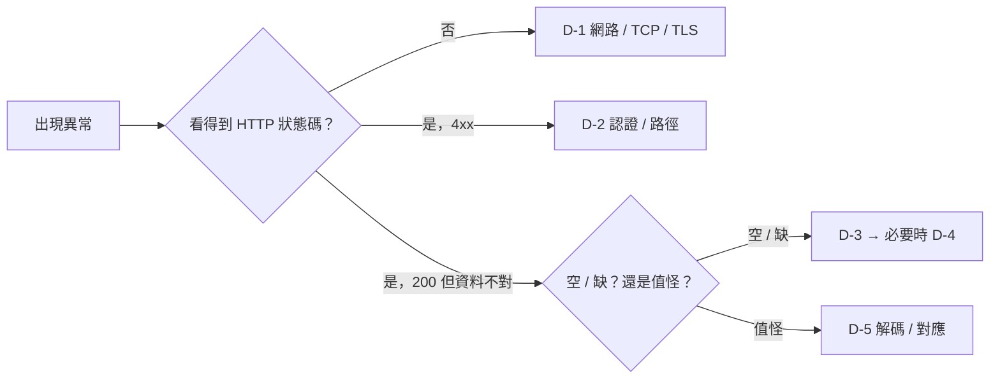

# 整合實作專題與 Lab

> 📌 **一句話重點**：四個專題把前 15 章串起來。A、B 不需要任何實機（用模擬伺服器與模擬資料）；C 需要設備支援；D 是整理成自己的 Debug Checklist。

所有 Lab 檔案都在 repo 的 `labs/` 目錄：

| 檔案 | 用途 |
|---|---|
| [`labs/mock_redfish_server.py`](labs/mock_redfish_server.py) | 只用 Python 標準函式庫的模擬 Redfish 伺服器（HTTP、僅供本機練習） |
| [`labs/redfish_inventory.py`](labs/redfish_inventory.py) | 第 8 章的 FirmwareInventory → CSV 程式 |
| [`labs/pmbus_decode.py`](labs/pmbus_decode.py) | 第 12 章的 Linear11／Linear16／DIRECT／STATUS_WORD 解碼 |
| [`labs/test_pmbus_decode.py`](labs/test_pmbus_decode.py) | 解碼測試（可直接執行或用 pytest） |

## Lab 0：環境準備

**🟢 可直接執行**

```bash
python3 --version              # 建議 3.9 以上
python3 -m venv .venv && source .venv/bin/activate
pip install requests pytest
```

## Project A：模擬 Redfish 伺服器 → FirmwareInventory → CSV

**目標**：不靠實機，練習「登入 → 跟著連結走 → 容錯 → 匯出 CSV → 登出」。

**前置條件**：Python 3、`requests`。

### 步驟

**🟢 可直接執行（僅本機 127.0.0.1）**

```bash
# 終端機 1：啟動模擬伺服器（帳號 labuser，密碼由環境變數指定）
export MOCK_PASSWORD='choose-a-lab-password'
python3 labs/mock_redfish_server.py            # 預設聽 127.0.0.1:8000
```

```bash
# 終端機 2：先用 curl 探索
curl -s http://127.0.0.1:8000/redfish/v1/ | python3 -m json.tool
curl -s -i -u labuser http://127.0.0.1:8000/redfish/v1/UpdateService

# 再執行程式
export BMC_BASE_URL='http://127.0.0.1:8000'
export BMC_USER='labuser'
read -s -p 'password: ' BMC_PASSWORD && export BMC_PASSWORD
python3 labs/redfish_inventory.py
cat firmware_inventory.csv
```

> ⚠️ 模擬伺服器用的是**明文 HTTP**，只為了在本機練習 API 流程；它**不是**真實 BMC 的行為模型（真實設備是 HTTPS，資源與欄位更多）。不要把它對外開放。

**預期輸出**

```text
已輸出 6 筆
```

CSV 內應有 BMC、UEFI、4 筆 PSU 項目；其中一筆故意設計成 `Version` 為空、另一筆成員 GET 會回 500，用來驗證你的容錯。

### 失敗排查

| 症狀 | 原因 |
|---|---|
| `Connection refused` | 伺服器沒啟動或 Port 不同 |
| 401 | 密碼與 `MOCK_PASSWORD` 不一致 |
| `KeyError: 'BMC_BASE_URL'` | 環境變數沒設（每個終端機各自獨立） |
| 中文 CSV 在 Excel 亂碼 | 用 `utf-8-sig` 編碼（程式已處理） |

### 延伸任務

1. 幫 `firmware_rows()` 寫 pytest：用 `unittest.mock` 或 `responses` 套件模擬 404、500、空 `Members`、缺 `Version`。
2. 加上重試：遇到 503 時等待 `Retry-After` 秒，最多 3 次。
3. 新增 `--psu-map psu_map.json` 參數，讓「哪個成員 Id 對應 PSU 幾號」由設定檔決定，而不是寫死字串比對。
4. 啟動伺服器時加上 `--fail-session`（回 503），確認程式給出清楚訊息而不是 traceback。

**驗收**：密碼不在程式碼與 shell history 中；所有請求有 timeout；任何成員失敗不影響其他成員；結束時 Session 已被 DELETE（伺服器端會印出）。

## Project B：解析 PMBus raw sample 並畫趨勢

**目標**：把一批 raw word 解成物理量並畫圖，體會 Linear11 的解析度變化。

**🟢 可直接執行**

```bash
python3 labs/test_pmbus_decode.py     # 全部 PASS
pip install matplotlib
```

模擬資料（存成 `samples.csv`）：

```text
t_s,vout_mode,read_vout,read_iout,read_pout
0,0x17,0x1800,0xD1F4,0xF178
1,0x17,0x1803,0xD280,0xF1E1
2,0x17,0x17F9,0xDA58,0xF381
3,0x17,0x17F0,0xE3E8,0x02EC
4,0x17,0x17F2,0xE3E6,0x02EB
```

```python
import csv
import matplotlib.pyplot as plt
from labs.pmbus_decode import linear11, linear16     # 於 repo 根目錄執行

t, v, i, p = [], [], [], []
with open("samples.csv", newline="") as f:
    for row in csv.DictReader(f):
        mode = int(row["vout_mode"], 16)
        t.append(float(row["t_s"]))
        v.append(linear16(int(row["read_vout"], 16), mode))
        i.append(linear11(int(row["read_iout"], 16)))
        p.append(linear11(int(row["read_pout"], 16)))

fig, (a1, a2) = plt.subplots(2, 1, sharex=True)
a1.plot(t, v, marker="o"); a1.set_ylabel("VOUT (V)")
a2.plot(t, p, marker="o"); a2.set_ylabel("POUT (W)"); a2.set_xlabel("time (s)")
fig.savefig("trend.png", dpi=150)

for row in zip(t, v, i, p):
    print("t=%.0fs  V=%.3f V  I=%.3f A  P=%.1f W  (V×I=%.1f W)" % (*row, row[1] * row[2]))
```

**觀察重點**

- POUT 的指數 N 隨功率變大而改變（`0xF178` 的 N=−2 → `0x02EC` 的 N=0），解析度從 0.25 W 變成 1 W。
- 比較 `V × I` 與 `READ_POUT`：兩者接近但不完全相等（取樣時間、解析度、PSU 內部計算方式不同）。

**延伸**：加入 PEC 驗證（第 11 章的 `pec()`）；加入 `STATUS_WORD` 欄位並在圖上標出 Fault 發生點；把讀到 `0xFFFF` 的樣本標為無效而非畫出來。

## Project C：IPMI 與 Redfish 交叉比對（🟡 需設備支援與授權）

**目標**：同一台設備上，從兩個介面讀 PSU Health 與功率並比對。

**前置條件**：授權的測試機；BMC 同時啟用 IPMI over LAN 與 Redfish；有唯讀帳號。

**步驟**

1. 用第 8 章方法找出 PSU 資源與功率欄位；用 `ipmitool sdr type "Power Supply"`、`sensor list` 找出對應感測器。
2. **建立對應表**（哪個 IPMI 感測器 ↔ 哪個 Redfish PSU），存成設定檔。
3. 在穩態負載下，每 5 秒各讀一次，持續 5 分鐘，連同時間戳存 CSV。
4. 計算每筆差值、平均差、最大差；依預先定義的容差判定。
5. 拔除一顆備援 PSU 的 AC（**確認允許且系統有備援**），比較兩邊狀態變化與 SEL／LogService 的事件時間。

**報告應包含**：設備型號與韌體版本、對應表、容差定義、統計結果、不一致時的原因分析（參考第 12 章第 7 節）。

**若設備不支援**：記錄「此平台不提供 X」，這本身就是有效結論——不要用猜的補值。

## Project D：BMC／SMM／PSU 通訊故障 Debug Checklist

把下表複製成你自己的檢核表，依實際平台增修。

### D-1　BMC 連線逾時

- [ ] 網路線接在**管理埠**，Link 燈亮（`ip link` 有 `LOWER_UP`）
- [ ] 本機 IP 與 BMC 同子網路（`ip addr`、`ip route get <BMC_IP>` 沒有走錯網卡）
- [ ] `ip neigh` 有 BMC 的 MAC
- [ ] BMC 已上電並開機完成（AC 插上後等待數分鐘）
- [ ] `ping`；不通再測 `nc -vz <BMC_IP> 443`
- [ ] 無 IP 衝突（`arping`／拔線後 ping 還通就代表有另一台）
- [ ] 必要時 `tcpdump` 確認 SYN 是否有回應

### D-2　API 回 401

- [ ] 帳號／密碼正確（注意大小寫、鍵盤配置、特殊字元被 shell 展開）
- [ ] 帳號未被鎖定、未過期、未被要求首次登入改密碼
- [ ] 使用 Token 時：是否過期？Header 名稱是 `X-Auth-Token`？
- [ ] Session 數量是否已滿（舊 Session 沒登出）
- [ ] 連的是預期的那台 BMC（IP 沒打錯）

### D-3　FirmwareInventory 空值／缺項

- [ ] 從 `UpdateService` 取得的連結，而非寫死路徑
- [ ] 連的是管理該元件的控制器（節點 BMC vs SMM）
- [ ] BMC 開機後已等待盤點完成
- [ ] 該 PSU 在位且有 AC
- [ ] 逐一 GET 成員，分辨「成員不存在」與「成員存在但 `Version` 為 null」
- [ ] 與 Web UI、Chassis PowerSupplies 的 `FirmwareVersion` 交叉比對
- [ ] 保留原始 JSON 回應作為佐證

### D-4　PSU I²C NACK（🟡 僅授權設備、唯讀）

- [ ] 位址用的是 **7-bit**（規格書 > 0x7F 的值要右移 1 位）
- [ ] bus 編號正確（`i2cdetect -l`；MUX 子通道是不同 bus）
- [ ] MUX 通道已選擇／由核心驅動管理（`UU`）
- [ ] PSU 有待機電、Present 訊號正常
- [ ] 該命令在 PSU 規格中有支援（不支援可能 NACK 或回 0xFF）
- [ ] 沒有與 BMC 輪詢互相干擾（重試數次觀察）
- [ ] SDA／SCL 沒有被卡在低電位（示波器）
- [ ] 交換法：問題跟 PSU 還是跟槽位

### D-5　讀值存在但不合理

- [ ] 資料格式正確（Linear11 vs Linear16 vs DIRECT）
- [ ] VOUT 有搭配當下的 `VOUT_MODE`
- [ ] Byte Order（低位元組在前）
- [ ] 有號數處理（指數與尾數的二補數）
- [ ] 不是 `0xFFFF`／`0x0000` 這類無效值
- [ ] 與儀器量測在容差內



## 總驗收：你應該能做到

- [ ] 向同事解釋 BMC、IPMI、Redfish、TCP、HTTPS、API、JSON、PMBus 的關係
- [ ] 看懂 Redfish JSON 與 HTTP 狀態碼
- [ ] 用 Python 安全地查 Redfish、追蹤 `@odata.id`、輸出 CSV
- [ ] 判讀基本的 IPMI sensor／SEL／FRU 輸出
- [ ] 區分 I²C Address、Bus Number、PMBus Command Code
- [ ] 理解 Byte／Word／Block、PEC 與 Linear11／Linear16
- [ ] 依症狀判斷問題在網路、TLS、HTTP、權限、API、BMC、I²C 還是 PSU
- [ ] 設計一個簡單的 PSU Monitoring／Firmware Inventory 自動化系統
