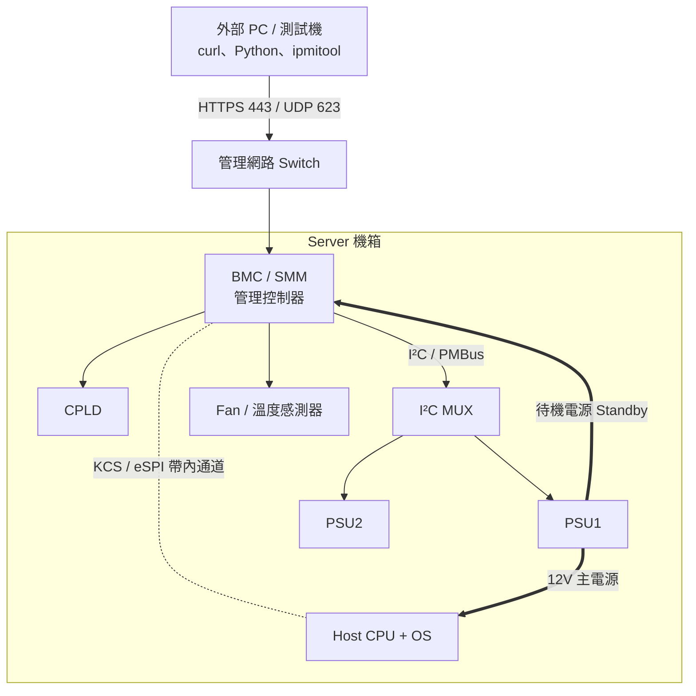
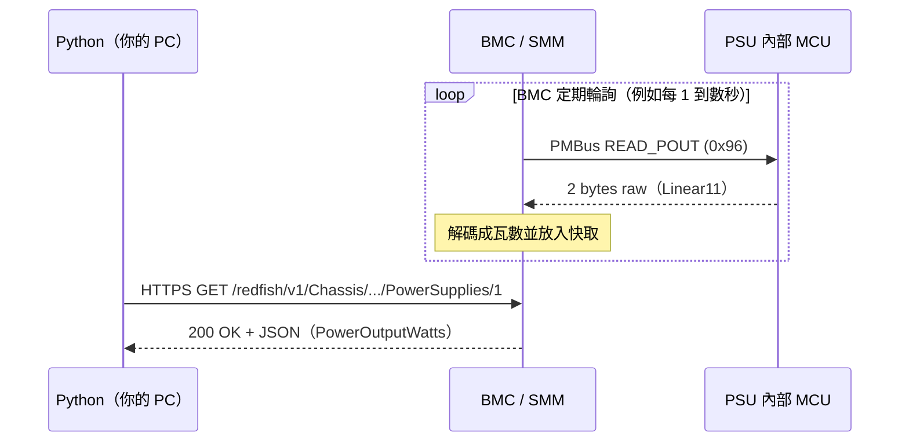

# Server、BMC、SMM、PSU 的角色

> 📌 **一句話重點**：伺服器裡其實有「兩台電腦」——跑作業系統的主機（Host），以及一顆獨立、永遠待命的小電腦 **BMC**。我們從外面查 PSU 電壓、功率、韌體版本，問的對象幾乎都是 BMC（或 SMM），不是主機 CPU。

## 1. 一台 Server 裡有哪些角色

| 元件 | 英文 | 做什麼 | 類比 |
|---|---|---|---|
| CPU ＋ OS | Host | 跑客戶的工作負載（Linux、VM、資料庫） | 大樓裡上班的公司 |
| 主機板 | Motherboard | 承載所有元件與匯流排 | 大樓本體 |
| NIC | Network Interface Card | 主機的網路卡（資料網路） | 大樓正門 |
| **BMC** | Baseboard Management Controller | 獨立的管理用小電腦（常見為 ARM SoC，跑嵌入式 Linux） | **大樓管理室／警衛** |
| PSU | Power Supply Unit | AC（或 HVDC）轉成 12 V／54 V 等直流給系統 | 大樓配電室 |
| Fan / Sensor | — | 散熱、溫度／電壓／電流感測 | 空調與各樓層感測器 |
| CPLD | Complex Programmable Logic Device | 上電時序、Presence、訊號轉接、Reset 控制 | 配電盤上的繼電器邏輯 |
| I²C MUX | I²C Multiplexer | 把一條 I²C 匯流排切到多個分支，解決位址衝突 | 電話總機的分機切換 |

圖 1-1　外部 PC → 管理網路 → BMC／SMM → 硬體的完整路徑（示意，實際拓樸依平台而異）

## 2. BMC 是什麼

**BMC（Baseboard Management Controller，基板管理控制器）** 是主機板上一顆獨立的管理晶片，有自己的 CPU、記憶體、Flash、韌體與網路介面。它負責：

- 讀取感測器：溫度、電壓、電流、風扇轉速、PSU 狀態
- 控制：開機／關機／重啟、風扇調速
- 記錄事件：System Event Log（SEL）
- 對外提供管理介面：**IPMI**、**Redfish**、Web UI、SSH
- 韌體清單與更新（Firmware Inventory / Update）

### BMC vs Host CPU vs OS

| | BMC | Host CPU ＋ OS |
|---|---|---|
| 目的 | 管理「這台機器本身」 | 執行使用者的運算工作 |
| 韌體／系統 | 嵌入式韌體（常見 OpenBMC 或廠商自有，Lenovo 稱 XCC） | Linux／Windows／ESXi |
| 供電 | **待機電源**（Standby），插上 AC 就活著 | 主電源，按下 Power 後才有 |
| 網路 | 管理網路（專用埠或與主機共用埠） | 資料網路 |
| OS 當機時 | 仍然可以連線、看 Log、強制重啟 | 無回應 |

## 3. 帶外管理與帶內管理

- **帶外管理（Out-of-Band, OOB）**：透過 BMC 的管理網路管理，不依賴主機 OS。OS 當掉、甚至還沒裝 OS 都能用。
- **帶內管理（In-Band）**：在主機 OS 內執行工具（例如本機 `ipmitool`、廠商 Agent），透過 KCS／eSPI 等主機介面跟 BMC 講話，或直接由 OS 讀硬體。

> 💡 **生活類比**：帶內＝打電話給辦公室裡的員工請他幫你看機器；帶外＝直接打給大樓管理室。員工下班（OS 關機）時，只有管理室還接電話。

## 4. OS 沒開機，BMC 為何還能運作？

PSU 通常有兩組輸出：

- **主輸出**（例如 12 V Main）：系統開機後才啟用，供 CPU、記憶體、硬碟。
- **待機輸出**（Standby，例如 12 V SB／3.3 V SB，依 PSU 規格而定）：只要 AC 插著就一直有，功率不大，專門供 BMC、CPLD、部分管理電路。

所以「關機」的伺服器只是主電源關閉；BMC 還醒著，能回應網路、讀取 PSU 的 PMBus 資料。

> ⚠️ **注意**：待機狀態下 PSU 的部分 Telemetry（例如輸出電流、輸出功率）會接近 0 或不更新，這是正常的，不代表通訊壞掉。

## 5. SMM／SMM3 與一般 BMC

**SMM（System Management Module）** 是 Lenovo 部分高密度／多節點機箱（Enclosure）上的**機箱層級**管理模組。概念上：

| | 節點 BMC（Lenovo 稱 XCC） | SMM／SMM2／SMM3 |
|---|---|---|
| 管理範圍 | **單一節點**（一塊主機板） | **整個機箱共用資源**：共用 PSU、風扇、機箱感測器 |
| 典型位置 | 每個節點各一顆 | 機箱後方一個模組 |
| PSU 資訊 | 多節點共用 PSU 的平台上，節點 BMC 可能看不到完整 PSU 資料 | 共用 PSU 的 Telemetry、Firmware 常在這裡 |

> ⚠️ **不要武斷視為同一顆控制器**。同樣是「連到一個 IP、打 Redfish」，你連到的可能是節點 BMC，也可能是機箱的 SMM。兩者支援的 Redfish 資源、IPMI 命令、PSU 資料完整度都可能不同。**哪個代號的 SMM 搭配哪些機型、支援哪些 API，需依實機與 Lenovo 官方文件驗證。**

判斷「我現在連的是誰」的實用方法：

1. 讀 `GET /redfish/v1/Managers`，看 Manager 的 `ManagerType`、`Model`、`FirmwareVersion`。
2. 讀 `GET /redfish/v1/Chassis`，看有幾個 Chassis、名稱是什麼。
3. 對照機型文件的管理架構圖。

## 6. PSU 會回報哪些資訊

| 類別 | 項目 | 說明 |
|---|---|---|
| Presence | 是否插入 | 通常是一根 Present 腳位（經 CPLD／GPIO），不一定走 PMBus |
| Health / Status | OK／Warning／Critical | BMC 綜合 Fault、Warning 後給出的結論 |
| Fault | OVP、OCP、OTP、UVP、Fan Fault、Input Lost… | 來自 PMBus `STATUS_*` 暫存器或 Alert 腳位 |
| Input | VIN、IIN、PIN | 輸入電壓、電流、功率 |
| Output | VOUT、IOUT、POUT | 輸出電壓、電流、功率 |
| Temperature | 進風／內部熱點 | `READ_TEMPERATURE_1/2/3` |
| Fan | 轉速 | `READ_FAN_SPEED_1` |
| Inventory | 型號、序號、韌體版本 | FRU EEPROM 或 PMBus `MFR_*` 命令 |

這些統稱 **Telemetry（遙測資料）**。

## 7. 一筆資料的完整旅程

重點：你的 Python **不是即時去問 PSU**，而是問 BMC「你最近一次輪詢到的值」。這解釋了為什麼 Redfish 讀值和你用儀器量到的瞬時值會有時間差（詳見 [第 13 章](#/doc/ch13)）。

## 8. 常見誤解

| 誤解 | 正確觀念 |
|---|---|
| 「Server 關機就連不到 BMC」 | 只要 AC 插著、有待機電源，BMC 就活著 |
| 「BMC 的 IP 就是 Server 的 IP」 | BMC 有自己的 MAC／IP；主機 OS 的 IP 是另一個 |
| 「SMM3 就是 BMC 的另一個名字」 | SMM 是機箱層級模組，與節點 BMC 角色不同，需依平台辨識 |
| 「Redfish 直接讀 PSU」 | Redfish 問的是 BMC；BMC 再用 PMBus 等方式讀 PSU |
| 「看得到 PSU Present 就代表 PMBus 通訊正常」 | Presence 常是獨立腳位，與 PMBus 是否能通是兩回事 |

## 9. Debug 思路：我連不到／讀不到時先問自己

1. 我連的 IP 是 **BMC／SMM** 還是 **Host OS**？
2. AC 有插嗎？BMC 開機完成了嗎？（BMC 上電後通常需要一到數分鐘才就緒）
3. 我的 PC 與 BMC 在同一個子網路或有路由嗎？（[第 3 章](#/doc/ch03)、[第 14 章](#/doc/ch14)）
4. 這個平台的 PSU 是歸節點 BMC 管，還是機箱 SMM 管？

## 10. 練習題

**Q1.** BMC 與主機 CPU 最根本的差異是什麼？

看解答

BMC 是獨立的管理用控制器，有自己的處理器、韌體、網路介面，並由待機電源供電；它的任務是監控與管理硬體本身，而主機 CPU 是執行使用者工作負載。因此主機 OS 關機或當機時 BMC 仍可運作。

**Q2.** 什麼是帶外管理？請舉一個只有帶外管理能做到的情境。

看解答

不依賴主機 OS、透過 BMC 管理網路進行的管理。例：OS Kernel Panic 完全無回應時，仍可用 Redfish／IPMI 讀 SEL、強制 Power Cycle。

**Q3.** 為什麼伺服器「關機」時還能讀到 PSU 的輸入電壓？

看解答

PSU 的待機輸出持續供電給 BMC，PSU 內部 MCU 也仍在運作，BMC 能透過 PMBus 讀取 `READ_VIN` 等資料。但輸出電流／功率會很小。

**Q4.** 在多節點共用 PSU 的機箱上，為什麼要先確認連的是節點 BMC 還是 SMM？

看解答

共用 PSU 多半由機箱層級的 SMM 管理，節點 BMC 可能沒有完整的 PSU Telemetry／Firmware 資訊。連錯對象會得到「空集合」或「缺欄位」，容易誤判成故障。

**Q5.** PSU Presence 顯示 Present，但 Telemetry 全空，可能代表什麼？

看解答

Presence 是獨立訊號，只代表 PSU 有插入。Telemetry 空可能是 PMBus／I²C 通訊問題（位址、MUX、NACK）、BMC 尚未完成輪詢、或該平台 BMC 不負責此 PSU。需逐層定位（見第 13、14 章）。

**🔧 動手練習**：找一台你有權限的測試機，畫出它的管理拓樸：管理埠在哪、BMC／SMM 的 IP 各是多少、PSU 由誰管理。不確定的地方標上「待驗證」。
