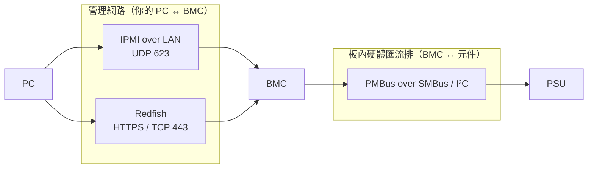
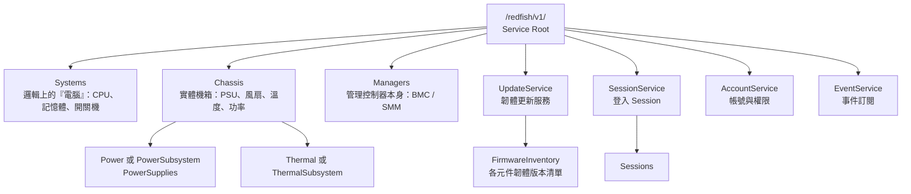
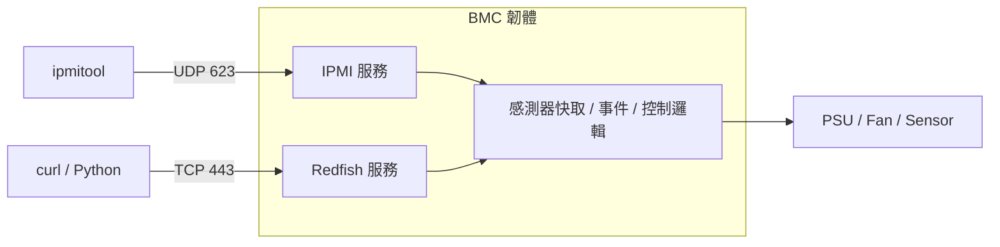

# IPMI 與 Redfish 的異同

> 📌 **一句話重點**：IPMI 與 Redfish 都是「從外面跟 BMC 講話」的管理介面。IPMI 是較早期的**二進位命令式**協定（常見 UDP 623）；Redfish 是現代的 **HTTPS ＋ JSON 的 RESTful API**（常見 TCP 443）。兩者都**不是** I²C／PMBus。

## 1. 三個容易混淆的層級



| 協定 | 誰跟誰講話 | 跑在哪裡 |
|---|---|---|
| IPMI | 管理者 ↔ BMC | 網路（LAN）或主機內部介面（KCS） |
| Redfish | 管理者 ↔ BMC | 網路（HTTPS） |
| PMBus | BMC ↔ PSU／VR | 板上兩條線（SDA／SCL） |

> ⚠️ **IPMI 不等於 I²C**。IPMI 規範裡確實有一種板內通道叫 IPMB（建立在 I²C 之上），但我們平常說「用 IPMI 查 Server」指的是 IPMI over LAN。

## 2. IPMI 是什麼

**IPMI（Intelligent Platform Management Interface，智慧平台管理介面）** 由 Intel、HP、NEC、Dell 於 1998 年提出，目前常見版本為 2.0。它定義了一組**命令式**的訊息格式。

### 2.1 一個 IPMI 請求長什麼樣

<div class="frame"><span class="a">NetFn<small>功能群組</small></span><span class="c">Cmd<small>命令碼</small></span><span class="d">Data…<small>參數</small></span></div>

回應則是：

<div class="frame"><span class="k">Completion Code<small>0x00 = 成功</small></span><span class="d">Data…<small>回傳資料</small></span></div>

| NetFn | 名稱 | 用途 |
|---|---|---|
| `0x00` | Chassis | 電源控制、機箱狀態 |
| `0x04` | Sensor/Event | 感測器讀值、事件 |
| `0x06` | App | 裝置 ID、Session、Watchdog |
| `0x0A` | Storage | SDR、SEL、FRU 存取 |
| `0x0C` | Transport | LAN 設定 |
| `0x2E`／`0x30`–`0x3F` | Group／OEM | **廠商自訂**，格式不公開就不能猜 |

### 2.2 IPMI 的四大資料庫

| 縮寫 | 全名 | 內容 | 類比 |
|---|---|---|---|
| **SDR** | Sensor Data Record | 「有哪些感測器、怎麼換算、門檻值多少」的描述 | 感測器的說明書目錄 |
| **Sensor** | — | 感測器當下讀值 | 儀表板 |
| **SEL** | System Event Log | 事件歷史（PSU 拔除、過溫…） | 警衛的值班日誌 |
| **FRU** | Field Replaceable Unit | 可更換元件的料號、序號、製造商 | 設備銘牌 |

### 2.3 IPMI over LAN

- 封裝：**RMCP**（Remote Management Control Protocol），IPMI 2.0 使用 **RMCP+**。
- 傳輸：**UDP port 623**。
- `ipmitool` 介面選項：`-I lan`（IPMI 1.5）／`-I lanplus`（IPMI 2.0，建議）。

> ⚠️ **安全注意**：IPMI 2.0 的 RAKP 認證流程有已知弱點（攻擊者可取得密碼雜湊做離線破解），早期設定還可能開啟「Cipher Suite 0」（免認證）。實務上：管理網路必須隔離、使用強密碼、不用時關閉 IPMI over LAN。

### 2.4 常用唯讀命令

**🟡 需要設備與帳號**

```bash
ipmitool -I lanplus -H <BMC_IP> -U <USER> sensor list
ipmitool -I lanplus -H <BMC_IP> -U <USER> sdr list
ipmitool -I lanplus -H <BMC_IP> -U <USER> sel list
ipmitool -I lanplus -H <BMC_IP> -U <USER> fru print
ipmitool -I lanplus -H <BMC_IP> -U <USER> chassis power status
```

不帶 `-P` 時 ipmitool 會互動式詢問密碼。各選項詳解見 [第 9 章](#/doc/ch09)。**並非每台設備都支援每個命令**（例如 SMM 可能只支援部分）。

## 3. Redfish 是什麼

**Redfish** 是 **DMTF**（Distributed Management Task Force）制定的伺服器管理標準，設計目標是取代 IPMI 的不足：

- 傳輸：**HTTPS**（TCP 443）
- 風格：**RESTful**——每個硬體元件是一個「資源」，有自己的 URI
- 資料：**JSON**，人看得懂、程式好解析
- 結構：**Schema** 定義每種資源有哪些欄位；使用 **OData** 慣例（`@odata.id`、`@odata.type`）
- 入口：**Service Root** `/redfish/v1/`

### 3.1 資源樹


<p class="figcap">圖 2-1　Redfish 常見資源樹。實際有哪些節點必須從 Service Root 一路跟著連結走，不可假設。</p>

| 資源 | 白話 | PSU 驗證常看什麼 |
|---|---|---|
| `Systems` | 「這台電腦」的邏輯視角 | PowerState、Reset Action |
| `Chassis` | 「這個鐵箱子」的實體視角 | **PSU、功率、溫度、風扇** |
| `Managers` | BMC／SMM 自己 | BMC 韌體版本、網路設定 |
| `UpdateService` | 韌體更新入口 | 是否支援更新、支援哪些協定 |
| `FirmwareInventory` | 韌體清單 | **各 PSU 韌體版本** |
| `SessionService` | 登入管理 | 取得 `X-Auth-Token` |

## 4. 並排比較

| 面向 | IPMI | Redfish |
|---|---|---|
| 年代 | 1998 起，2.0 後幾乎不再演進 | 2015 起，持續更新 |
| 傳輸 | UDP 623（RMCP／RMCP+） | TCP 443（HTTPS） |
| 資料格式 | 二進位 bytes | JSON 文字 |
| 模型 | 命令式：NetFn＋Cmd | 資源導向：URI＋HTTP Method |
| 感測器 | SDR＋Sensor Reading | `Sensors`、`Power`、`Thermal` 等資源 |
| 事件 | SEL | `LogServices`、`EventService`（可訂閱推送） |
| 電源控制 | `chassis power on/off/cycle` | `ComputerSystem.Reset` Action |
| 韌體清單／更新 | 無統一標準，多靠 OEM 命令 | `UpdateService`、`FirmwareInventory` 有標準 Schema |
| 安全 | 已知弱點多，依賴網路隔離 | TLS 加密、Session、角色權限 |
| 自動化 | 需解析文字輸出或 raw bytes | 直接解析 JSON，適合大規模自動化 |
| 擴充 | OEM NetFn／raw | `Oem` 區塊、OEM Schema／Action |
| 工具 | `ipmitool` | `curl`、Python `requests`、任何 HTTP 用戶端 |

### 為什麼兩者能管理同一台 Server？

因為**它們只是 BMC 對外的兩個「窗口」**，後面是同一顆 BMC、同一份感測器資料。



所以同一個 PSU 功率，從兩邊讀到的值「應該接近」但未必完全相同（換算、四捨五入、更新時間點不同）。

## 5. 怎麼選

| 情境 | 建議 |
|---|---|
| 舊平台、只需基本感測器／開關機 | IPMI 夠用 |
| 需要韌體清單、結構化資料、大量機台自動化 | 優先評估 Redfish |
| 需要廠商特有功能 | 看該功能在哪一邊有實作（OEM raw 或 Redfish Oem） |
| 兩邊都有 | 可交叉核對，提升驗證可信度 |

> ⚠️ 不能假設 Redfish 已完全取代 IPMI：有些平台的某些資料只在其中一邊提供，**需依實機驗證**。

## 6. 常見誤解

| 誤解 | 正確觀念 |
|---|---|
| IPMI 是 DMTF 的標準 | IPMI 由 Intel 等廠商主導；Redfish 才是 DMTF 標準 |
| Redfish 是一種新的網路協定 | Redfish 是**建立在 HTTPS 上的 API 規範**，網路協定仍是 TCP／TLS／HTTP |
| IPMI 走 I²C 所以連不到是 I²C 問題 | IPMI over LAN 走 UDP 623，連不到先查網路 |
| 兩邊數值不同代表其中一邊壞了 | 多半是取樣時間與換算差異 |

## 7. 練習題

**Q1.** 說明 NetFn 與 Cmd 在 IPMI 訊息中的角色。

<details><summary>看解答</summary>

NetFn（Network Function）是命令的「功能群組」，例如 Chassis、Sensor、Storage；Cmd 是群組內的具體命令編號。兩者合起來才唯一決定一個 IPMI 命令，後面接參數 Data。

</details>

**Q2.** SDR 與 SEL 的差別？

<details><summary>看解答</summary>

SDR 是感測器的「描述資料」（有哪些感測器、單位、換算公式、門檻）；SEL 是「事件歷史紀錄」。前者偏靜態，後者隨事件增加。

</details>

**Q3.** 為什麼 IPMI 常見 UDP 623，Redfish 常見 TCP 443？

<details><summary>看解答</summary>

IPMI over LAN 以 RMCP／RMCP+ 封裝，規範使用 UDP 623，可靠性由 IPMI 自己的序號／重試處理。Redfish 建立在 HTTPS 上，而 HTTPS 預設為 TCP 443，由 TCP 提供可靠傳輸、TLS 提供加密。

</details>

**Q4.** `Systems`、`Chassis`、`Managers` 分別代表什麼？PSU 通常掛在哪？

<details><summary>看解答</summary>

Systems＝邏輯上的電腦系統；Chassis＝實體機箱與其中的電源、散熱；Managers＝BMC／SMM 管理控制器本身。PSU 屬於實體機箱，通常在 Chassis 之下的 Power 或 PowerSubsystem。

</details>

**Q5.** IPMI、Redfish、PMBus 哪些在管理網路、哪個在硬體匯流排？

<details><summary>看解答</summary>

IPMI（over LAN）與 Redfish 在管理網路，是「人／程式 ↔ BMC」的介面；PMBus 在板上的 SMBus／I²C 匯流排，是「BMC ↔ PSU」的協定。

</details>

**🔧 動手練習**：在有權限的測試機上，分別用 `ipmitool ... sdr list` 與瀏覽器開啟 `https://<BMC_IP>/redfish/v1/`（Service Root 通常免登入），比較兩者回應的「樣子」，記錄你的第一印象。
