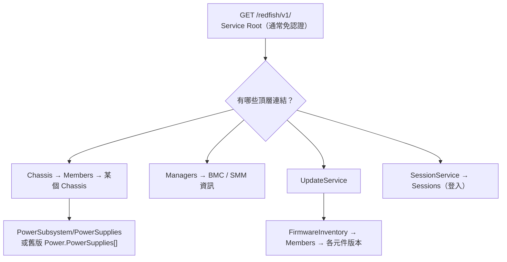
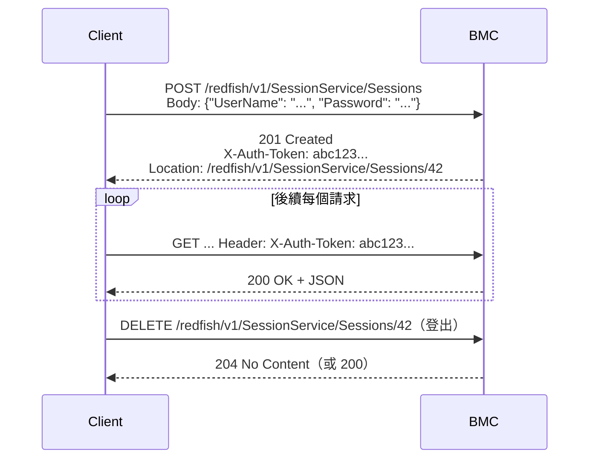

# Redfish 從 curl 到 Python

> 📌 **一句話重點**：Redfish 的正確用法是**「從 Service Root 出發，跟著 `@odata.id` 連結走」**，不要把別台機器的路徑寫死。認證有兩種：每次都帶帳密的 Basic Auth，以及先登入拿 Token 的 Session。

## 1. 探索流程總覽



## 2. 用 curl 一步步走

**🟢 可執行（需填參數、唯讀）** — 隔離實驗環境且 BMC 為自簽憑證時，可暫時把 `--cacert <CA_CERT_PATH>` 換成 `-k`（風險見 [第 5 章](#/doc/ch05)）。

```bash
# ① Service Root
curl --cacert <CA_CERT_PATH> -s 'https://<BMC_IP>/redfish/v1/' | python3 -m json.tool

# ② 需要認證的資源：-u 只給帳號，密碼互動輸入
curl --cacert <CA_CERT_PATH> -s -u '<USER>' 'https://<BMC_IP>/redfish/v1/Chassis' | python3 -m json.tool

# ③ 先看 UpdateService，確認 FirmwareInventory 的實際連結
curl --cacert <CA_CERT_PATH> -s -u '<USER>' 'https://<BMC_IP>/redfish/v1/UpdateService' | python3 -m json.tool

# ④ 再讀 FirmwareInventory（URL 以 ③ 回傳的 @odata.id 為準）
curl --cacert <CA_CERT_PATH> -s -u '<USER>' 'https://<BMC_IP>/redfish/v1/UpdateService/FirmwareInventory' | python3 -m json.tool
```

Service Root 回應範例（模擬、節錄）：

```json
{
  "@odata.id": "/redfish/v1/",
  "RedfishVersion": "1.15.0",
  "Systems":        { "@odata.id": "/redfish/v1/Systems" },
  "Chassis":        { "@odata.id": "/redfish/v1/Chassis" },
  "Managers":       { "@odata.id": "/redfish/v1/Managers" },
  "UpdateService":  { "@odata.id": "/redfish/v1/UpdateService" },
  "SessionService": { "@odata.id": "/redfish/v1/SessionService" },
  "Links": { "Sessions": { "@odata.id": "/redfish/v1/SessionService/Sessions" } }
}
```

> ⚠️ **不要假設路徑固定**。`/redfish/v1/UpdateService/FirmwareInventory` 很常見，但成員名稱（`PSU1`？`PCS1`？`Slot_1.Bundle`？）、Chassis ID（`1`？`Enclosure`？）完全依廠商與機型而定。

## 3. PSU 資料在哪：新舊兩種模型

| 模型 | 路徑樣式 | 說明 |
|---|---|---|
| 舊：`Power` | `/redfish/v1/Chassis/{id}/Power` → `PowerSupplies[]` 陣列、`PowerControl[]`、`Voltages[]` | 一個大資源包含所有 PSU；新版 Schema 已標示為 deprecated，但大量設備仍在使用 |
| 新：`PowerSubsystem` | `/redfish/v1/Chassis/{id}/PowerSubsystem/PowerSupplies/{id}`，讀值在 `.../Metrics` 或 `/Chassis/{id}/Sensors` | 每顆 PSU 是獨立資源 |

舊模型常見欄位（實際有哪些需依實機驗證）：`Name`、`Model`、`SerialNumber`、`FirmwareVersion`、`PowerCapacityWatts`、`LineInputVoltage`、`PowerInputWatts`、`PowerOutputWatts`、`LastPowerOutputWatts`、`Status`。

## 4. 認證方式

### 4.1 Basic Auth

每個請求都帶 `Authorization: Basic <base64(user:password)>`。簡單，但每次都傳送帳密（所以一定要 HTTPS）。

### 4.2 Redfish Session（建議用於多次請求）



| 重點 | 說明 |
|---|---|
| Token 在哪 | 回應 **Header** 的 `X-Auth-Token`（不是 Body） |
| Session 位址 | 回應 Header 的 `Location`，登出時 DELETE 這個 URI |
| 逾時 | 閒置一段時間自動失效（見 `SessionService` 的 `SessionTimeout`）→ 之後會得到 401 |
| 數量限制 | BMC 的 Session 數量有上限；**不登出會把名額用完**，導致後續登入失敗 |
| 版本差異 | Sessions 集合的實際 URI 以 Service Root 的 `Links.Sessions` 為準；少數舊實作行為不同，需依實機驗證 |

> 🔴 Token 等同密碼：不要印到 Log、不要寫進程式碼或 commit 進 Git。

## 5. Python `requests` 基礎

**🟢 可執行（需設定環境變數、唯讀）**

```bash
# 在 shell 設定（密碼用 read -s，不會顯示也不進 history）
export BMC_BASE_URL='https://<BMC_IP>'
export BMC_USER='<USER>'
read -s -p 'BMC password: ' BMC_PASSWORD && export BMC_PASSWORD
export BMC_CA_BUNDLE='<CA_CERT_PATH>'     # 沒有就不設，使用系統預設 CA
```

```python
import os
import requests

base = os.environ["BMC_BASE_URL"].rstrip("/")
user = os.environ["BMC_USER"]
password = os.environ["BMC_PASSWORD"]
ca_bundle = os.environ.get("BMC_CA_BUNDLE", True)   # True = 使用系統 CA 驗證

response = requests.get(
    f"{base}/redfish/v1/",
    auth=(user, password),   # Basic Auth
    timeout=10,              # 一定要設，否則可能永遠卡住
    verify=ca_bundle,        # 憑證驗證；verify=False 僅限隔離實驗
)
response.raise_for_status()  # 4xx / 5xx 會丟出 HTTPError
print(response.json())
```

| 參數／方法 | 意義 |
|---|---|
| `timeout=10` 或 `timeout=(3, 10)` | 連線逾時／讀取逾時；**requests 預設沒有逾時** |
| `verify=` | `True`（預設）／CA 檔路徑／`False`（不驗證，僅實驗） |
| `response.status_code` | HTTP 狀態碼 |
| `response.raise_for_status()` | 非 2xx 就丟例外 |
| `response.json()` | 解析 Body 成 dict／list |
| `requests.Session()` | 重用 TCP／TLS 連線並共用 Header，速度快很多 |

### 例外對應到哪一層

| 例外 | 層級 |
|---|---|
| `requests.exceptions.ConnectTimeout` | IP／TCP：連不上（逾時） |
| `requests.exceptions.ConnectionError` | TCP：refused、無路由、DNS 失敗 |
| `requests.exceptions.SSLError` | TLS：憑證驗證失敗 |
| `requests.exceptions.ReadTimeout` | 連上了但 BMC 回應太慢 |
| `requests.exceptions.HTTPError` | HTTP 4xx／5xx（由 `raise_for_status()` 產生） |
| `requests.exceptions.JSONDecodeError` | Body 不是合法 JSON |

## 6. 完整範例：列出 FirmwareInventory 並匯出 CSV

這支程式示範：Session 登入 → 跟著連結走 → 容錯 → 匯出 CSV → **保證登出**。完整檔案在 repo 的 [`labs/redfish_inventory.py`](labs/redfish_inventory.py)，可搭配 [第 16 章](#/doc/ch16) 的模擬伺服器在沒有實機的情況下執行。

```python
import csv, os, sys
import requests


class Redfish:
    def __init__(self, base, user, password, verify=True, timeout=(5, 20)):
        self.base, self.timeout = base.rstrip("/"), timeout
        self.http = requests.Session()
        self.http.verify = verify
        self.session_uri = None
        self._login(user, password)

    def _login(self, user, password):
        root = self.http.get(self.base + "/redfish/v1/", timeout=self.timeout)
        root.raise_for_status()
        # Sessions 位置以 Service Root 的連結為準，不寫死
        sessions = (root.json().get("Links", {}).get("Sessions", {})
                    .get("@odata.id", "/redfish/v1/SessionService/Sessions"))
        r = self.http.post(self.base + sessions,
                           json={"UserName": user, "Password": password},
                           timeout=self.timeout)
        r.raise_for_status()
        self.http.headers["X-Auth-Token"] = r.headers["X-Auth-Token"]
        self.session_uri = r.headers.get("Location")

    def get(self, uri):
        r = self.http.get(self.base + uri, timeout=self.timeout)
        r.raise_for_status()
        return r.json()

    def close(self):
        if self.session_uri:
            uri = self.session_uri
            if uri.startswith("http"):                 # 有些實作回傳完整 URL
                uri = "/" + uri.split("/", 3)[3]
            try:
                self.http.delete(self.base + uri, timeout=self.timeout)
            except requests.RequestException:
                pass                                    # 登出失敗不影響結果

    def __enter__(self): return self
    def __exit__(self, *exc): self.close()


def firmware_rows(rf):
    update = rf.get("/redfish/v1/UpdateService")
    link = (update.get("FirmwareInventory") or {}).get("@odata.id")
    if not link:
        print("此平台的 UpdateService 沒有 FirmwareInventory 連結", file=sys.stderr)
        return
    for member in rf.get(link).get("Members", []):
        try:
            item = rf.get(member["@odata.id"])
        except requests.HTTPError as e:
            yield {"Id": member["@odata.id"], "Error": str(e.response.status_code)}
            continue
        yield {
            "Id": item.get("Id"),
            "Name": item.get("Name"),
            "Version": item.get("Version"),              # 可能為 None
            "Updateable": item.get("Updateable"),
            "Health": (item.get("Status") or {}).get("Health"),
        }


if __name__ == "__main__":
    verify = os.environ.get("BMC_CA_BUNDLE", True)
    with Redfish(os.environ["BMC_BASE_URL"], os.environ["BMC_USER"],
                 os.environ["BMC_PASSWORD"], verify=verify) as rf:
        rows = list(firmware_rows(rf))
    fields = ["Id", "Name", "Version", "Updateable", "Health", "Error"]
    with open("firmware_inventory.csv", "w", newline="", encoding="utf-8-sig") as f:
        w = csv.DictWriter(f, fieldnames=fields)
        w.writeheader(); w.writerows(rows)
    print(f"已輸出 {len(rows)} 筆")
```

> 💡 `encoding="utf-8-sig"` 讓 Excel 直接開啟 CSV 時中文不會亂碼。

依 PSU 編號產生報告時，**不要用字串猜**（例如 `"PSU" in name`）當唯一依據；先人工看過這個平台的命名（例如某些 Lenovo SMM 平台的 PSU 項目可能叫 `PCS1`–`PCS4`，需依實機驗證），把對應表寫在設定檔裡。

## 7. 錯誤處理對照

| 症狀 | 可能原因 | 處理 |
|---|---|---|
| 401 | 帳密錯、Token 過期、帳號被鎖 | 重新登入；確認帳號狀態；注意連續失敗會鎖帳 |
| 403 | 角色權限不足 | 換有權限的帳號；只讀操作通常 ReadOnly 即可 |
| 404 | 路徑不存在 | 回到上一層看連結；平台可能不支援 |
| 405 | Method 不支援 | 看 `Allow` Header |
| 500／503 | BMC 內部錯誤／忙碌 | 等待後重試（有上限的 backoff）；仍失敗則收集 BMC Log |
| 200 但 `Members` 為空 | 服務存在但沒有項目；BMC 尚未完成盤點；連錯控制器 | 等 BMC 開機完成再試；確認是否該問 SMM |
| 200 但欄位缺少／為 `null` | 平台不提供該屬性；元件不在位 | 記錄為「未提供」，不要補 0 |

## 8. 重要觀念：看得到版本 ≠ 能更新

`FirmwareInventory` 只是**清單**。能不能透過 Redfish 更新要看：

1. 該項目的 `Updateable` 是否為 `true`；
2. `UpdateService` 是否提供 `SimpleUpdate` Action 或 `MultipartHttpPushUri`，以及支援的 `TransferProtocol`；
3. 廠商是否要求用專用工具或特定流程（見 [第 15 章](#/doc/ch15)）。

## 9. 練習題

**Q1.** 為什麼要從 Service Root 開始而不是直接打已知路徑？

<details><summary>看解答</summary>

各廠商／機型的資源 ID 與結構不同，Redfish 的設計是以超連結（`@odata.id`）導覽。從根開始可確認資源是否存在並取得正確路徑，程式才具可移植性。

</details>

**Q2.** Basic Auth 與 Session Token 的差別與各自適用情境？

<details><summary>看解答</summary>

Basic 每次請求帶帳密，適合單次查詢；Session 先 POST 登入取得 `X-Auth-Token`，之後帶 Token，結束時 DELETE 登出，適合多次請求的自動化，且減少帳密傳送次數。

</details>

**Q3.** Session 建立成功後，Token 與 Session URI 分別在回應的哪裡？

<details><summary>看解答</summary>

都在 **Response Header**：`X-Auth-Token` 與 `Location`。

</details>

**Q4.** 程式沒有登出會造成什麼問題？

<details><summary>看解答</summary>

Session 會佔用 BMC 有限的名額直到逾時；大量或頻繁執行時名額耗盡，之後的登入會失敗（常見 503 或 4xx）。

</details>

**Q5.** `requests.get()` 不設 `timeout` 會怎樣？

<details><summary>看解答</summary>

預設沒有逾時，BMC 無回應時程式可能無限期卡住，自動化流程整個停擺。

</details>

**🔧 動手練習**：用 [第 16 章](#/doc/ch16) 的模擬伺服器執行本章程式，產生 `firmware_inventory.csv`；然後故意把密碼設錯，確認程式得到 401 並給出清楚的錯誤訊息。
