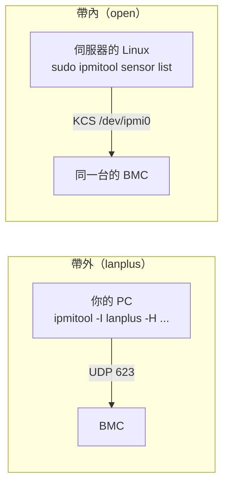
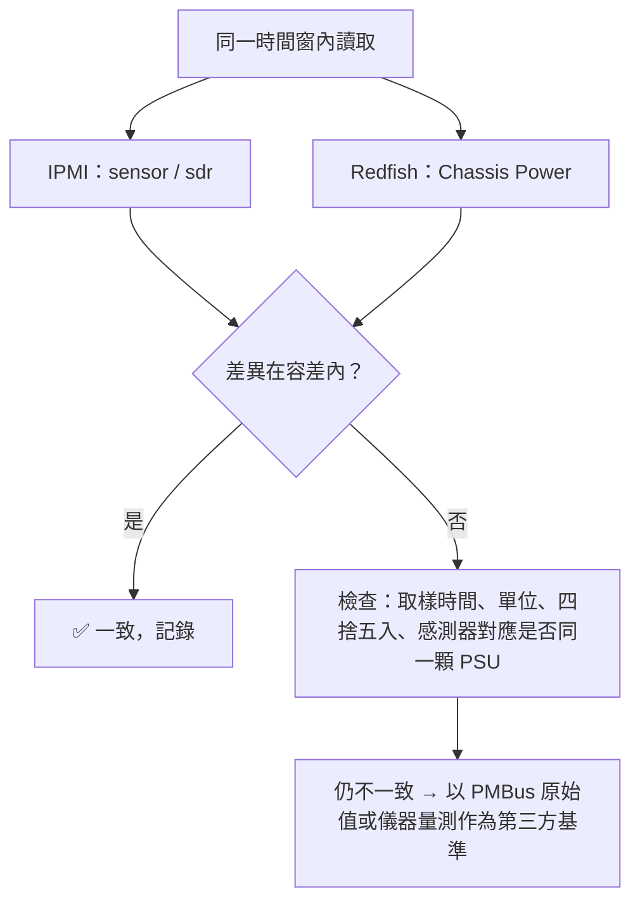

# IPMI 實作與限制

> 📌 **一句話重點**：`ipmitool` 的每個選項都對應一個具體問題——**用什麼介面（-I）、連誰（-H）、我是誰（-U）、做什麼（子命令）**。唯讀命令可以放心練；`raw` 與電源控制要非常小心。

## 1. 安裝與三種連線方式

**🟢 可執行**

```bash
# Ubuntu / Debian
sudo apt install ipmitool
# RHEL / CentOS
sudo yum install ipmitool

ipmitool -V
```

| 介面 `-I` | 路徑 | 需要 | 用途 |
|---|---|---|---|
| `open`（預設，本機） | Host OS → KCS／系統介面 → 本機 BMC | root、載入 `ipmi_si`／`ipmi_devintf` 模組 | **帶內**：在伺服器自己的 OS 內執行 |
| `lan` | 網路 → BMC（IPMI 1.5） | BMC IP、帳密 | 舊式，不加密，不建議 |
| **`lanplus`** | 網路 → BMC（IPMI 2.0／RMCP+） | BMC IP、帳密 | **帶外的標準選擇** |



## 2. 命令逐段拆解

```bash
ipmitool -I lanplus -H <BMC_IP> -U <USER> sensor list
```

<div class="frame"><span class="p">ipmitool</span><span class="rw">-I lanplus<small>介面：IPMI 2.0 over LAN</small></span><span class="a">-H &lt;BMC_IP&gt;<small>目標主機</small></span><span class="k">-U &lt;USER&gt;<small>使用者</small></span><span class="c">sensor list<small>子命令</small></span></div>

| 選項 | 意義 |
|---|---|
| `-I lanplus` | 使用 RMCP+（IPMI 2.0） |
| `-H <BMC_IP>` | BMC 的 IP 或主機名稱 |
| `-U <USER>` | 帳號 |
| （不給密碼選項） | **互動詢問密碼**，最安全的手動用法 |
| `-E` | 從環境變數 `IPMI_PASSWORD` 讀密碼（適合腳本） |
| `-f <檔>` | 從檔案讀密碼（檔案權限設 600） |
| `-P <密碼>` | 命令列直接給密碼——**避免使用**：會留在 history 與 `ps` |
| `-p <port>` | 非預設埠（預設 623） |
| `-L <權限>` | 要求的權限等級：`USER`／`OPERATOR`／`ADMINISTRATOR`；帳號權限較低時需指定 |
| `-C <n>` | Cipher Suite；某些 BMC 需指定（常見 `-C 17` 或 `-C 3`），依設備而定 |
| `-v`／`-vv` | 詳細輸出，Debug 用 |

**🟡 需要設備與帳號（唯讀）** — 腳本用法：

```bash
read -s -p 'IPMI password: ' IPMI_PASSWORD && export IPMI_PASSWORD
ipmitool -I lanplus -H <BMC_IP> -U <USER> -E chassis power status
```

## 3. 常用唯讀命令與輸出判讀

### 3.1 `sensor list`

```text
PSU1 Input Power | 412.000    | Watts      | ok    | na  | na  | na  | 1500.000 | 1600.000 | na
PSU1 Temp        | 34.000     | degrees C  | ok    | na  | na  | na  | 60.000   | 65.000   | na
PSU2 Status      | 0x0        | discrete   | 0x0180| na  | na  | na  | na       | na       | na
Fan1 Speed       | na         | RPM        | na    | ...
```
<p class="figcap">模擬輸出：感測器名稱與數量依平台而異</p>

欄位依序：名稱｜讀值｜單位｜狀態｜下限 LNR／LCR／LNC｜上限 UNC／UCR／UNR。

| 門檻縮寫 | 意義 |
|---|---|
| LNC／UNC | Lower／Upper Non-Critical（警告） |
| LCR／UCR | Lower／Upper Critical（嚴重） |
| LNR／UNR | Lower／Upper Non-Recoverable（不可恢復） |

- 狀態 `ok`／`nc`／`cr`／`nr`；`na` 代表目前讀不到（感測器不存在、主機關機、或掃描關閉）。
- **threshold（類比）感測器**有數值；**discrete（離散）感測器**是一組狀態 bit。

### 3.2 `sdr list`／`sdr elist`／`sdr type`

```bash
ipmitool ... sdr elist                  # 多了感測器編號與 Entity ID
ipmitool ... sdr type "Power Supply"    # 只看電源供應器類
ipmitool ... sdr type Temperature
```

```text
PSU1 Status      | 60h | ok  | 10.1 | Presence detected
PSU2 Status      | 61h | ok  | 10.2 | Presence detected, Power Supply AC lost
```

`10.1`、`10.2` 是 **Entity ID.Instance**：Entity ID `10`（0x0A）＝Power Supply。

### 3.3 PSU「Presence」與「Fault」是不同的事

Power Supply 型別的離散感測器，常見狀態位元（IPMI 規範 Sensor Type 0x08）：

| 狀態 | 意義 |
|---|---|
| Presence detected | PSU 有插入 |
| Power Supply Failure detected | PSU 故障 |
| Predictive Failure | 預測性故障 |
| Power Supply AC lost | 輸入電源遺失 |
| AC lost or out-of-range／AC out-of-range, but present | 輸入異常 |
| Configuration error | 型號不符／設定錯誤 |

> ⚠️ 「Presence detected」只代表有插；同時還可能有 Failure 或 AC lost。**驗證 PSU 狀態要看完整的狀態位元**，不能只看有沒有 Present。

### 3.4 `sel list`／`sel elist`

```text
   1 | 11/12/2026 | 09:14:22 | Power Supply #0x61 | Power Supply AC lost | Asserted
   2 | 11/12/2026 | 09:14:51 | Power Supply #0x61 | Power Supply AC lost | Deasserted
```

- **Asserted**＝事件發生；**Deasserted**＝事件解除。
- 做 PSU 插拔、AC cycle、Fault injection 驗證時，SEL 是主要的佐證。
- `sel info` 可看筆數與空間；`sel clear` 會**清除紀錄**（🔴 不可逆，先存檔 `sel save <檔>` 並確認允許）。

### 3.5 `fru print`

```text
FRU Device Description : PSU1 (ID 3)
 Product Manufacturer  : <VENDOR>
 Product Name          : <MODEL>
 Product Part Number   : <PN>
 Product Version       : <REV>
 Product Serial        : <SN>
```

FRU 是 PSU 內 EEPROM 的靜態資料。**是否包含韌體版本依廠商而定**；很多平台的 PSU 韌體版本要從 Redfish FirmwareInventory 或 OEM 命令取得。

### 3.6 `chassis` 與 `mc`

| 命令 | 作用 | 風險 |
|---|---|---|
| `chassis status` | 電源狀態、上次開機原因 | 🟢 唯讀 |
| `chassis power status` | `Chassis Power is on/off` | 🟢 唯讀 |
| `mc info` | BMC 韌體版本、IPMI 版本、廠商 ID | 🟢 唯讀 |
| `lan print` | BMC 網路設定 | 🟢 唯讀 |
| `chassis power off / cycle / reset` | **強制**斷電／重啟主機 | 🔴 可能造成資料遺失 |
| `mc reset cold` | 重啟 BMC | 🔴 管理中斷數分鐘 |

## 4. RAW 與 OEM 命令的風險

```bash
ipmitool ... raw <NetFn> <Cmd> [data...]
```

**⚪ 純示意（標準命令 Get Device ID，唯讀）**

```bash
ipmitool -I lanplus -H <BMC_IP> -U <USER> raw 0x06 0x01
```

> 🔴 **OEM／RAW 命令不能猜**
> - `raw` 會把你給的 bytes 原封不動送給 BMC，**沒有任何檢查**。
> - OEM NetFn（`0x2E`、`0x30`–`0x3F`）的命令碼與資料格式是廠商私有的；同一組 bytes 在不同機型可能意義完全不同——可能是讀版本，也可能是改設定或進入更新模式。
> - 只能使用**有正式文件**（廠商規格、已核可的測試計畫）的 raw 命令，並記錄來源。

有些平台提供「IPMI Master Write-Read」（`raw 0x06 0x52 ...`）讓 BMC 代為發 I²C 交易；這等同直接操作板上匯流排，風險與 [第 11 章](#/doc/ch11) 的 `i2cset`／`i2ctransfer` 相同，且多數平台預設限制或關閉。

## 5. IPMI 與 Redfish 交叉核對

同一項 PSU Telemetry 從兩個介面讀，是很好的驗證手法：

| 項目 | IPMI | Redfish |
|---|---|---|
| PSU 在位 | `sdr type "Power Supply"` → Presence detected | PowerSupply `Status.State` = `Enabled`／`Absent` |
| 健康 | 離散狀態位元、SEL | `Status.Health` |
| 輸入功率 | `sensor list` 的 Input Power | `PowerInputWatts` 或 Sensors |
| 序號／料號 | `fru print` | `SerialNumber`／`PartNumber` |
| 韌體版本 | 多半需 OEM | `FirmwareVersion`／FirmwareInventory |

比對策略：

1. **盡量同時取樣**（兩邊的請求間隔 < BMC 更新週期），並記錄時間戳。
2. 設定合理容差：例如功率差異在數瓦或 1–2 % 內視為一致（實際容差依規格訂）。
3. 取多筆做平均或看趨勢，不以單筆判定。
4. 先在**穩態負載**下比；動態負載時差異本來就大。
5. 有落差時記錄：兩邊數值、時間、負載條件、BMC 韌體版本。



## 6. 常見問題排查

| 訊息 | 可能原因 |
|---|---|
| `Error: Unable to establish IPMI v2 / RMCP+ session` | IP／帳密錯、IPMI over LAN 未啟用、UDP 623 被擋、Cipher Suite 不合（試 `-C 17`／`-C 3`）、帳號權限需 `-L` |
| `Could not open device at /dev/ipmi0` | 本機模式但驅動未載入或非 root |
| `Insufficient privilege level` | 帳號權限不足 |
| `Invalid command`／completion code `0xc1` | 此 BMC 不支援該命令 |
| 感測器全部 `na` | 主機關機、BMC 尚未掃描完成 |

## 7. 練習題

**Q1.** `-I lanplus` 與不加 `-I` 有什麼差別？

<details><summary>看解答</summary>

`lanplus` 經由網路以 IPMI 2.0（RMCP+，UDP 623）連到遠端 BMC（帶外）；不加時預設用本機系統介面（`open`），只能在伺服器自己的 OS 內對本機 BMC 操作（帶內）。

</details>

**Q2.** 為什麼不建議用 `-P`？有哪些替代方案？

<details><summary>看解答</summary>

密碼會出現在 shell history 與行程參數中。替代：不給密碼選項（互動輸入）、`-E` 搭配環境變數 `IPMI_PASSWORD`、`-f` 密碼檔（權限 600）。

</details>

**Q3.** SDR 顯示 `Presence detected, Power Supply AC lost`，這顆 PSU 的狀態是？

<details><summary>看解答</summary>

PSU 有插在槽位上，但輸入 AC 遺失（沒插電源線或上游斷電）。它是「在位但異常」，不是正常。

</details>

**Q4.** 為什麼 OEM raw 命令不能照網路上的範例直接試？

<details><summary>看解答</summary>

OEM 命令格式為廠商／機型私有，同樣的 bytes 在不同設備可能觸發不同行為（包含修改設定或進入更新模式）；`raw` 完全不做檢查，可能造成設備異常甚至損壞。

</details>

**Q5.** IPMI 與 Redfish 讀到的 PSU 輸入功率相差 3 W，如何判斷是否正常？

<details><summary>看解答</summary>

先確認兩次讀取的時間差、負載是否穩態、兩邊的解析度／四捨五入方式，以及是否對應同一顆 PSU。小幅差異通常源自取樣時間與換算，屬正常；應以多筆資料與預先定義的容差判定。

</details>

**🔧 動手練習**（🟡 需設備）：在授權測試機上執行 `sdr type "Power Supply"` 與 `sel elist`，拔掉一顆備援 PSU 的 AC（**先確認系統有備援且允許此測試**），觀察狀態與 SEL 的變化並截圖記錄。

---

## 🧩 整合題（第 7–9 章）

你要寫一支每日自動檢查腳本，回報每顆 PSU 的「在位、健康、韌體版本、輸入功率」。請說明你會從哪個介面取哪一項、JSON 缺欄位時怎麼處理、以及憑證與密碼如何保存。

<details><summary>看解答</summary>

- **介面選擇**：優先用 Redfish（結構化 JSON、有 FirmwareInventory）；在位／健康／功率取自 Chassis 的 PowerSupplies，韌體版本取自 FirmwareInventory。IPMI `sdr type "Power Supply"` 作為在位與 AC lost 的交叉核對。
- **缺欄位**：用 `.get()`／安全取值函式；把「未提供」「null」「0」分開記錄；集合為空時標記為異常並保留原始回應以利追查。
- **憑證與密碼**：密碼放環境變數或權限 600 的設定檔／密鑰管理工具，不寫進程式與 Git；使用 Session Token 並在 `finally` 登出；TLS 以公司 CA 或匯出的 BMC 憑證驗證（`verify=<CA 檔>`），不使用 `verify=False`。
- **其他**：所有請求設 `timeout`；失敗有上限地重試；Log 中遮蔽 Token。

</details>
